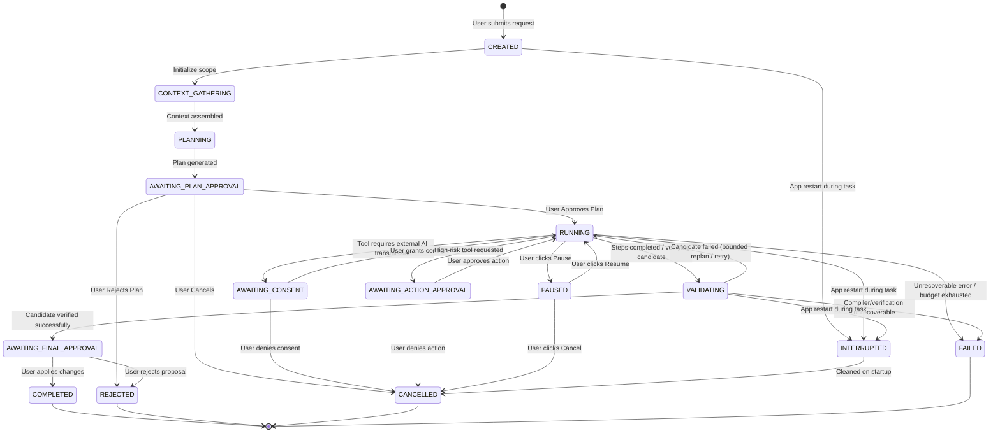

# ADR-007: Unified Agent Orchestration, State Machine, Tool Governance, and Supervised Autonomy

- **Status:** Proposed (Awaiting Maintainer Approval)
- **Date:** 2026-11-09
- **Scope:** Application Layer Orchestration, Core Domain Policies, Tool Registry, Task State Machine, Risk Governance, Consent Boundaries, SQLite Journaling
- **Authoritative Baseline:** Commit `25bb95d198c34c035b5d66513166e06494d82cdb`
- **Related ADRs:** ADR-001 (Three-Way Merge), ADR-004 (Artifact Lineage & OCC), ADR-006 (LaTeX Repair Contract), ADR-008 (Working Copy & Patch Architecture), ADR-009 (Quarto Diagnostics & PDF Repair), ADR-010 (Publication Style System)
- **Confirmed Requirements:** D-USER-01 (Unified Assistant Scope), D-USER-02 (Supervised Agent Autonomy), D-USER-03 (Document vs Rendering-System Repair)

---

## 1. Context

Polpo is an embedded, desktop-first, serverless document workspace. The application currently features point-to-point AI integrations, including Pipeline 2 OCR text refinement ([ADR-004](file:///home/amirreza-a2a/DevelopPOlpo/PolpoT/docs/adr/2026-10-22-adr-004-pipeline2-artifact-lineage-and-canonical-publication-contract.md)) and AI-assisted LaTeX error repair ([ADR-006](file:///home/amirreza-a2a/DevelopPOlpo/PolpoT/docs/adr/2026-11-07-adr-006-ai-assisted-latex-repair.md)). However, document engineering workflows frequently require cross-cutting capabilities: diagnosing PDF compilation failures, validating mathematical formulas, adjusting publication typography, inspecting technical diagrams (TikZ/PGFPlots/CircuitTikZ), and restructuring Markdown content.

Implementing disconnected chatbots or independent AI scripts for each feature produces code duplication, inconsistent UX, uncoordinated token spending, and security risks. Under maintainer directive **D-USER-01**, Polpo requires a single unified AI Assistant orchestrated through a shared, provider-neutral architecture. Furthermore, under directive **D-USER-02**, the assistant must operate under a **Supervised Agent** autonomy model, balancing automated multi-step investigation with mandatory human authorization checkpoints.

---

## 2. Problem Statement

How should Polpo structure the central Agent orchestration system so that:
1. A single assistant coordinates diverse document-engineering tasks without building independent, fragmented agents?
2. AI execution remains 100% provider-neutral, avoiding tight coupling to vendor-specific function calling SDKs in application services?
3. Autonomous actions are strictly bounded, preventing runaway loops, accidental data loss, or silent file mutations?
4. External AI transmissions and high-risk actions are governed by deterministic application policies and explicit user consent?
5. Tasks can be paused, resumed, safely cancelled, and audited across application restarts without duplicate network calls or inconsistent state?

---

## 3. Architectural Forces & Constraints

1. **Clean Architecture & Dependency Inversion ([`AGENTS.md`](file:///home/amirreza-a2a/DevelopPOlpo/PolpoT/AGENTS.md) Rule 6):** Core domain and application services must not import PySide6, Qt, SQLite, or concrete vendor AI SDKs.
2. **Serverless & Local-First ([`AGENTS.md`](file:///home/amirreza-a2a/DevelopPOlpo/PolpoT/AGENTS.md) Rules 2 & 3):** No remote backend servers, no loopback REST daemons (`127.0.0.1:8000`), no VPS infrastructure.
3. **Hardware-Grade Credential Security ([`AGENTS.md`](file:///home/amirreza-a2a/DevelopPOlpo/PolpoT/AGENTS.md) Rules 10 & 11):** Plaintext API secrets must never enter prompt templates, task journals, or serialized DTOs.
4. **Cooperative Cancellation ([`AGENTS.md`](file:///home/amirreza-a2a/DevelopPOlpo/PolpoT/AGENTS.md) Rule 14):** Workers must not be terminated abruptly; state transitions must be thread-safe.
5. **No Model Self-Authorization:** The LLM cannot decide whether an action is permissible; permissions are evaluated deterministically by the application runtime.
6. **Token & Cost Budgeting:** Tasks must have strict upper bounds on steps, retries, and execution time to prevent rate-limit depletion.

---

## 4. Confirmed Requirements (Maintainer Settled)

- **D-USER-01 (Unified Assistant Scope):** The product provides a single unified AI Assistant coordinating multiple document-engineering capabilities (LaTeX repair, Quarto/PDF diagnostics, Markdown editing, math inspection, diagram validation, publication styling) through a shared orchestration engine.
- **D-USER-02 (Supervised Agent Autonomy):** The assistant can understand requests, formulate multi-step plans, call approved internal tools, and prepare candidate changes in isolated scratchpads. However, the user must approve the execution plan before consequential execution begins; external transmissions require explicit consent; and canonical document adoption requires explicit human confirmation.
- **D-USER-03 (Repair Scope Separation):** Document repairs, publication style configuration, preamble adjustments, and product defect reports must remain strictly separated.

---

## 5. Considered Alternatives

### Alternative A: Provider-Native Function Calling (OpenAI Tools / Gemini Function Calling)
- *Description:* Directly bind provider-specific tool schemas to the model call.
- *Rejection Rationale:* Each provider uses a different tool-calling API and schema representation. Implementing native function calling in the application layer violates Clean Architecture by binding domain logic to external vendor SDK shapes. Furthermore, fallback chain progression (`Gemini` $\to$ `OpenAI`) becomes fragile when translating vendor-specific function calling responses mid-task.

### Alternative B: Unrestricted General-Purpose ReAct Agent
- *Description:* Allow the LLM to recursively plan, execute shell commands, and read arbitrary files until it decides to stop.
- *Rejection Rationale:* Violates security boundaries ([`AGENTS.md`](file:///home/amirreza-a2a/DevelopPOlpo/PolpoT/AGENTS.md) Rule 28, Section 7). Unrestricted shell execution or filesystem access introduces severe prompt injection vulnerabilities and unpredictable token consumption.

### Alternative C: Proposed Decision — Provider-Neutral Structured JSON Orchestrator with Allowlisted Tool Registry
- *Description:* The Agent uses Polpo's existing [`IAIExecutionService`](file:///home/amirreza-a2a/DevelopPOlpo/PolpoT/application/ports/ai_executor.py) to generate structured, machine-readable JSON plans and tool requests. A deterministic application-owned `ToolRegistry` and `RiskPolicyGovernor` validate and dispatch tool calls.
- *Selection Rationale:* Completely decouples application code from vendor SDKs; leverages existing rate-limiting and fallback chain progression; guarantees deterministic security enforcement.

---

## 6. Proposed Decision

We propose establishing the **Unified Agent Orchestration System** composed of:
1. A **Provider-Neutral Agent Orchestrator** in `application/services/agent_orchestration_service.py`.
2. A typed, allowlisted **Tool Registry** in `application/services/tool_registry.py`.
3. A formal **Task State Machine** governed by `core/policies/agent_task_policy.py`.
4. A deterministic **Risk & Governance Policy** classifying tool risk levels.
5. Append-only **SQLite Task Persistence & Journaling** for auditability and safe startup recovery.

---

## 7. Detailed Design

### 7.1 Architecture & Component Boundaries

```text
Presentation Layer (interfaces/desktop)
 └── controllers/agent_controller.py (Qt Controller: binds signals, translates UI slots)
Application Layer (application/)
 ├── services/agent_orchestration_service.py (Central Orchestrator)
 ├── services/tool_registry.py (Typed Allowlisted Tool Registry)
 ├── ports/agent_task_repository.py (IAgentTaskRepository Port)
 └── dto/agent_dto.py (Typed Plan, Step, ToolCall, and Event DTOs)
Core Domain (core/)
 ├── entities/agent_task.py (AgentTask, AgentPlan, PlanStep, ToolCall)
 ├── policies/agent_task_policy.py (Valid state transitions & invariants)
 └── policies/tool_governance_policy.py (Risk tiers & permission checks)
Infrastructure Layer (infrastructure/)
 ├── persistence/sqlite/agent_task_repository.py (SQLite WAL Task Journal)
 └── ai/executor_service.py (Existing RateLimitedAIExecutor)
```

### 7.2 Complete Task State Machine

The task lifecycle is modeled as a deterministic finite-state aggregate (`AgentTask`):



#### State Transition Invariants:
1. **Terminal States:** `COMPLETED`, `REJECTED`, `CANCELLED`, `FAILED`. No transitions out of terminal states are permitted.
2. **Pre-Execution Checkpoint (`AWAITING_PLAN_APPROVAL`):** Consequential execution cannot start until the human user reviews and explicitly approves the multi-step plan.
3. **Restart Invariant (`INTERRUPTED`):** Any task that was in an active non-terminal state (`RUNNING`, `VALIDATING`, `PLANNING`) when the application crashed or was terminated transitions to `INTERRUPTED` upon application startup. The orchestrator **never silently resumes network operations or disk mutations** upon restart.

### 7.3 Tool Governance & Risk Classification

Every tool registered in `ToolRegistry` is assigned an immutable risk level:

| Risk Tier | Definition | Permissions | Required Authorization | Examples |
| :--- | :--- | :--- | :--- | :--- |
| **`READ_ONLY`** | Inspects read-only in-memory AST, diagnostics, or document metadata. Zero side effects. | Autonomous | None (pre-authorized by plan approval) | `read_document_structure`, `inspect_math`, `inspect_diagrams`, `inspect_tex_log` |
| **`ISOLATED_MUTATION`** | Modifies temporary `AgentWorkingCopy` or creates ephemeral compilation in `.pdf_staging/`. | Autonomous | Pre-authorized by plan approval | `create_document_patch`, `apply_patch_to_working_copy`, `compile_pdf_candidate` |
| **`EXTERNAL_TRANSMISSION`** | Transmits document source fragments or compiler diagnostics to external cloud AI. | Gated | Explicit Pre-Transmission Consent (Payload preview disclosed) | `generate_latex_repair`, `generate_document_patch`, `analyze_style_profile` |
| **`CONSEQUENTIAL_SYSTEM`** | Installs LaTeX packages, modifies user application preferences, or creates external files. | Gated | Explicit Action Confirmation modal | `install_latex_packages`, `export_verified_pdf` |
| **`CANONICAL_ADOPTION`** | Applies patches to the active editor buffer or publishes a new canonical version. | Gated | Explicit Final Review & User Adoption ("Apply Changes") | `apply_changes_to_editor_buffer`, `publish_canonical_document` |

### 7.4 Typed Tool Registry Contract

Every tool implements the abstract application port `ITool`:

```python
class ITool(ABC):
    @property
    @abstractmethod
    def name(self) -> str:
        """Unique snake_case tool identifier."""
        pass

    @property
    @abstractmethod
    def description(self) -> str:
        """Concise English description of tool purpose and parameters."""
        pass

    @property
    @abstractmethod
    def risk_level(self) -> ToolRiskLevel:
        """Deterministic risk classification."""
        pass

    @abstractmethod
    def validate_arguments(self, args: Dict[str, Any]) -> Tuple[bool, Optional[str]]:
        """Validates arguments against schema prior to execution."""
        pass

    @abstractmethod
    def execute(self, context: ToolExecutionContext, args: Dict[str, Any]) -> ToolExecutionResult:
        """Executes tool logic and returns structured output."""
        pass
```

### 7.5 Machine-Readable Planning Contract

Communication with the AI provider for plan generation enforces a strict JSON schema:

```json
{
  "schema_version": 1,
  "task_goal": "Repair broken XeLaTeX compilation in strikethrough fragment",
  "assessed_scope": "CONFIGURATION_PREAMBLE",
  "steps": [
    {
      "step_index": 1,
      "tool_name": "inspect_diagnostic_bundle",
      "arguments": {"failure_id": "8f3b..."},
      "rationale": "Read failing generated TeX line and sanitized compiler log"
    },
    {
      "step_index": 2,
      "tool_name": "propose_publication_style_override",
      "arguments": {
        "override_type": "preamble_package",
        "package_name": "ulem",
        "macro_definition": "\\renewcommand{\\st}[1]{\\sout{#1}}"
      },
      "rationale": "Resolve soul package conflict with Persian RTL typesetting"
    },
    {
      "step_index": 3,
      "tool_name": "compile_pdf_candidate",
      "arguments": {"working_copy_id": "wc_123"},
      "rationale": "Verify that full Quarto XeLaTeX PDF export compiles cleanly"
    }
  ]
}
```

---

## 8. Dependency & Data Flow

```text
[User Request in QML]
         │
         ▼
[AgentController] ──(Dispatches via QThreadPool)──► [AgentOrchestrationService]
                                                             │
                  ┌──────────────────────────────────────────┴──────────────────────────┐
                  ▼                                                                     ▼
      [RateLimitedAIExecutor]                                                 [ToolRegistry]
  (Prompts model for JSON plan)                                              (Finds allowlisted tool)
                  │                                                                     │
                  ▼                                                                     ▼
         [AgentPlan DTO]                                                    [RiskPolicyGovernor]
                  │                                                       (Evaluates permissions)
                  ▼                                                                     │
     (AWAITING_PLAN_APPROVAL)                                            ┌──────────────┴──────────────┐
                  │                                                      ▼                             ▼
       [Qt Signal to UI]                                         [Autonomous Run]             [Consent/Approval Gated]
(User clicks "Approve Plan")                                     (READ_ONLY / ISOLATED)       (EXTERNAL_TRANSMISSION)
```

---

## 9. Security & Privacy Considerations

1. **Prompt Injection Defense:** Model outputs are treated as untrusted data. Tool names and arguments must match the strict allowlist and undergo schema validation before execution.
2. **Path Traversal & Command Injection:** Tools never invoke arbitrary shell processes (`shell=True` is prohibited; `-no-shell-escape` is mandatory). Subprocess commands use hardcoded executable paths.
3. **Data Minimization:** Diagnostics sent to AI providers are sanitized by `TexLogSanitizer` to redact absolute paths, usernames, and staging hashes.
4. **Secret Isolation:** Prompt contexts and task journals never contain raw API keys or passwords. Secrets reside strictly in the OS keyring.

---

## 10. Failure & Recovery Behavior

1. **Step Failure:** If a tool execution fails, the orchestrator does not crash. It logs the failure in the task journal, updates step status to `FAILED`, and either requests a bounded replan (max 1 replan attempt) or transitions the task to `FAILED`.
2. **Cooperative Cancellation:** When the user clicks "Cancel", the active cancellation token is flagged (`is_cancelled = True`). Long-running tools (Quarto compilation, AI HTTP requests) poll the token at internal checkpoints and terminate gracefully, transitioning the task to `CANCELLED`.
3. **Crash Recovery:** At application startup, `AgentRecoveryService` scans SQLite `agent_tasks`. Any task with status in `(RUNNING, VALIDATING, PLANNING)` is transitioned to `INTERRUPTED`. Associated temporary staging files in `.pdf_staging/` are purged.

---

## 11. Consequences

### Positive:
- **Unified User Experience:** A single coherent assistant interface in the desktop workspace replaces ad-hoc dialogs.
- **Strict Clean Architecture:** Application core remains 100% free from Qt and vendor SDK dependencies.
- **Auditability:** Complete, append-only SQLite journal tracks all decisions, tool calls, and user approvals.
- **Safety Guarantee:** Canonical documents and user settings cannot be mutated silently.

### Negative / Trade-offs:
- **Planning Latency:** Formulating a structured plan requires an initial round-trip to the configured AI provider before execution begins.
- **User Checkpoints:** Supervised autonomy requires user confirmation for plan approval and external consent, which adds UX interactions compared to fully autonomous scripts.

---

## 12. Migration & Rollout Strategy

1. **Phase 1 (Foundations):** Implement `AgentTask`, `ToolRegistry`, and `AgentOrchestrationService` with read-only document inspection tools.
2. **Phase 2 (Repair Integration):** Wrap existing `LaTeXRepairService` and `QuartoPdfExportService` as tools within `ToolRegistry`.
3. **Phase 3 (Desktop UI):** Integrate the Assistant review panel into `ReviewWorkspaceView.qml`.
4. **Backward Compatibility:** Existing direct repair buttons in `ReviewWorkspaceView.qml` remain operational as shortcut triggers into the unified assistant.

---

## 13. Testing & Verification Strategy

- **Domain Policy Tests:** Test state machine transitions in `core/policies/agent_task_policy.py`, verifying all invalid transitions raise `InvalidStateTransitionError`.
- **Tool Governance Tests:** Verify that high-risk tools cannot execute without explicit authorization tokens.
- **Orchestration Unit Tests:** Test `AgentOrchestrationService` with mocked `IAIExecutionService` and mock tools, verifying plan generation, consent pauses, and cancellation handling.
- **AST Architecture Invariant Tests:** Add static AST assertions verifying that `application/services/agent_orchestration_service.py` has zero imports of `PySide6`, `Qt`, `sqlite3`, `google.generativeai`, or `openai`.
