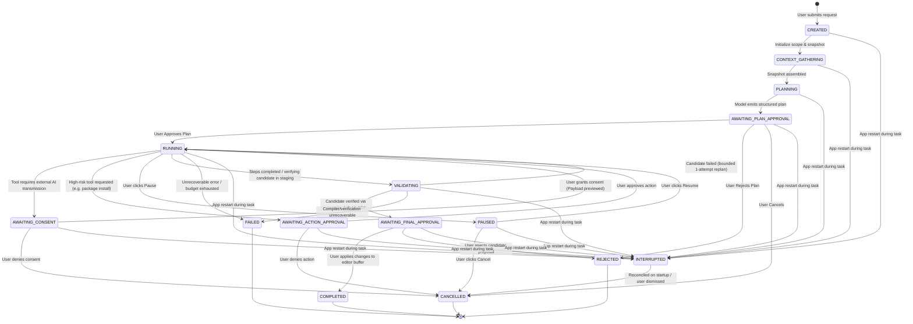

# ADR-007: Unified Agent Orchestration, State Machine, Tool Governance, and Supervised Autonomy

- **Status:** Proposed (Awaiting Maintainer Approval)
- **Date:** 2026-11-09 (Revised: 2026-11-11)
- **Scope:** Application Layer Orchestration, Core Domain Policies, Tool Registry, Task State Machine, Risk Governance, Consent Boundaries, SQLite Journaling, Conservative Crash Recovery
- **Authoritative Baseline:** Commit `25bb95d198c34c035b5d66513166e06494d82cdb`
- **Related ADRs:** ADR-001 (Three-Way Merge), ADR-004 (Artifact Lineage & OCC), ADR-006 (LaTeX Repair Contract), ADR-008 (Working Copy & Patch Architecture), ADR-009 (Quarto Diagnostics & PDF Repair), ADR-010 (Publication Style System)
- **Confirmed Requirements:** D-USER-01 (Unified Assistant Scope), D-USER-02 (Supervised Agent Autonomy), D-USER-03 (Document vs Rendering-System Repair)

---

## 1. Context

Polpo is an embedded, desktop-first, serverless document workspace. The application currently features point-to-point AI integrations, including Pipeline 2 OCR text refinement ([ADR-004](docs/adr/2026-10-22-adr-004-pipeline2-artifact-lineage-and-canonical-publication-contract.md)) and AI-assisted LaTeX error repair ([ADR-006](docs/adr/2026-11-07-adr-006-ai-assisted-latex-repair.md)). However, document engineering workflows frequently require cross-cutting capabilities: diagnosing PDF compilation failures, validating mathematical formulas, adjusting publication typography, inspecting technical diagrams (TikZ/PGFPlots/CircuitTikZ), and restructuring Markdown content.

Implementing disconnected chatbots or independent AI scripts for each feature produces code duplication, inconsistent UX, uncoordinated token spending, and security risks. Under maintainer directive **D-USER-01**, Polpo requires a single unified AI Assistant orchestrated through a shared, provider-neutral architecture. Furthermore, under directive **D-USER-02**, the assistant must operate under a **Supervised Agent** autonomy model, balancing automated multi-step investigation with mandatory human authorization checkpoints.

---

## 2. Problem Statement

How should Polpo structure the central Agent orchestration system so that:
1. A single assistant coordinates diverse document-engineering tasks without building independent, fragmented agents?
2. AI execution remains 100% provider-neutral, avoiding tight coupling to vendor-specific function calling SDKs in application services?
3. Autonomous actions are strictly bounded, preventing runaway loops, accidental data loss, or silent file mutations?
4. External AI transmissions and high-risk actions are governed by deterministic application policies and explicit user consent?
5. Tasks can be paused, resumed, safely cancelled, and audited across application restarts without duplicate network calls, uncertain outcome replays, or journal privacy leaks?

---

## 3. Architectural Forces & Constraints

1. **Clean Architecture & Dependency Inversion ([`AGENTS.md`](AGENTS.md) Rule 6):** Core domain and application services must not import PySide6, Qt, SQLite, or concrete vendor AI SDKs.
2. **Serverless & Local-First ([`AGENTS.md`](AGENTS.md) Rules 2 & 3):** No remote backend servers, no loopback REST daemons (`127.0.0.1:8000`), no VPS infrastructure.
3. **Hardware-Grade Credential Security ([`AGENTS.md`](AGENTS.md) Rules 10 & 11):** Plaintext API secrets must never enter prompt templates, task journals, or serialized DTOs.
4. **Cooperative Cancellation ([`AGENTS.md`](AGENTS.md) Rule 14):** Workers must not be terminated abruptly; state transitions must be thread-safe.
5. **No Model Self-Authorization:** The LLM cannot decide whether an action is permissible; permissions are evaluated deterministically by the application runtime.
6. **Token & Cost Budgeting:** Tasks must have strict upper bounds on steps, retries, and execution time to prevent rate-limit depletion.
7. **Zero Plaintext Secret or Document Leakage in Persistence ([`AGENTS.md`](AGENTS.md) Rules 10, 11 & Finding E):** The SQLite task journal must adhere to an explicit allowlist and never store full document contents, raw prompts, or credentials.

---

## 4. Confirmed Requirements (Maintainer Settled)

- **D-USER-01 (Unified Assistant Scope):** The product provides a single unified AI Assistant coordinating multiple document-engineering capabilities (LaTeX repair, Quarto/PDF diagnostics, Markdown editing, math inspection, diagram validation, publication styling) through a shared orchestration engine.
- **D-USER-02 (Supervised Agent Autonomy):** The assistant can understand requests, formulate multi-step plans, call approved internal tools, and prepare candidate changes in isolated scratchpads. However, the user must approve the execution plan before consequential execution begins; external transmissions require explicit consent; and canonical document adoption requires explicit human confirmation.
- **D-USER-03 (Repair Scope Separation):** Document repairs, publication style configuration, preamble adjustments, and product defect reports must remain strictly separated.

---

## 5. Ubiquitous Language & Supervised Autonomy Invariants (Finding K)

To eliminate conceptual ambiguity across the system, the following ubiquitous language terms are strictly enforced:

- **Agent:** The AI-powered reasoning entity operating under supervised autonomy to interpret requests, formulate plans, and inspect artifacts.
- **Orchestrator:** The application-layer service (`AgentOrchestrationService`) that coordinates task lifecycle, plan evaluation, tool dispatch, consent gates, and persistence.
- **Task:** The persistent domain aggregate (`AgentTask`) tracking the lifecycle, goals, policy bounds, and checkpoints of a user request.
- **Step:** An individual unit of execution (`PlanStep`) within a task plan, binding a specific allowlisted tool and arguments.
- **Plan:** The ordered sequence of steps (`AgentPlan`) generated by the model to fulfill a task, subject to mandatory user approval.
- **Tool:** A vetted, typed application port (`ITool`) exposing a specific capability to the orchestrator.
- **Tool Invocation:** A single deterministic execution of a tool with validated inputs and structured outputs.
- **Approval:** A human decision authorizing a plan, a high-risk tool action, or canonical patch adoption.
- **Consent:** An informed user authorization permitting transmission of minimized data payloads to an external AI provider.
- **Working Copy:** An isolated, in-memory document scratchpad (`AgentWorkingCopy`) where modifications are validated safely without mutating canonical files.
- **Patch:** A targeted, line-range modification (`DocumentPatch`) describing additions, deletions, or replacements on raw text.
- **Diagnostic Bundle:** A sanitized snapshot of compiler failure evidence (`DiagnosticBundle`) captured before staging workspace cleanup.
- **Publication Style Profile:** A versioned declarative specification (`PublicationStyleProfile`) governing PDF typography and geometry.
- **Render Operation:** A bounded compilation of a document or working copy through Quarto/XeLaTeX inside an ephemeral staging directory.

### Supervised Autonomy Invariants:
1. The Agent CANNOT silently change canonical document content on disk.
2. The Agent CANNOT silently publish or save a document, bypassing OCC.
3. The Agent CANNOT delete user files or purge unmanaged directories.
4. The Agent CANNOT alter application settings or OS keyring credentials.
5. The Agent CANNOT install software or TeX packages without explicit user action confirmation.
6. The Agent CANNOT execute arbitrary shell commands or launch uncontrolled processes.
7. The Agent CANNOT transmit full document text or unredacted diagnostics to external AI providers without prior payload disclosure and consent.
8. The Agent CANNOT inject arbitrary raw LaTeX macros into document preambles (Finding A, Finding F).

---

## 6. Considered Alternatives

### Alternative A: Provider-Native Function Calling (OpenAI Tools / Gemini Function Calling)
- *Description:* Directly bind provider-specific tool schemas to the model call.
- *Rejection Rationale:* Each provider uses a different tool-calling API and schema representation. Implementing native function calling in the application layer violates Clean Architecture by binding domain logic to external vendor SDK shapes. Furthermore, fallback chain progression (`Gemini` $\to$ `OpenAI`) becomes fragile when translating vendor-specific function calling responses mid-task.

### Alternative B: Unrestricted General-Purpose ReAct Agent
- *Description:* Allow the LLM to recursively plan, execute shell commands, and read arbitrary files until it decides to stop.
- *Rejection Rationale:* Violates security boundaries ([`AGENTS.md`](AGENTS.md) Rule 28, Section 7). Unrestricted shell execution or filesystem access introduces severe prompt injection vulnerabilities and unpredictable token consumption.

### Alternative C: Proposed Decision — Provider-Neutral Structured JSON Orchestrator with Allowlisted Tool Registry
- *Description:* The Agent uses Polpo's existing [`IAIExecutionService`](application/ports/ai_executor.py) to generate structured, machine-readable JSON plans and tool requests. A deterministic application-owned `ToolRegistry` and `RiskPolicyGovernor` validate and dispatch tool calls.
- *Selection Rationale:* Completely decouples application code from vendor SDKs; leverages existing rate-limiting and fallback chain progression; guarantees deterministic security enforcement.

---

## 7. Proposed Decision

We propose establishing the **Unified Agent Orchestration System** composed of:
1. A **Provider-Neutral Agent Orchestrator** in `application/services/agent_orchestration_service.py`.
2. A typed, allowlisted **Tool Registry** in `application/services/tool_registry.py`.
3. A formal **Task State Machine** governed by `core/policies/agent_task_policy.py`.
4. A deterministic **Risk & Governance Policy** classifying tool risk levels.
5. A **Conservative Task Recovery Model** handling restarts and network ambiguity without automated retries (Finding D).
6. Append-only **SQLite Task Persistence & Journaling** governed by an explicit privacy allowlist under migration `006_agent_task_tables.sql` (Finding E, Finding I).

---

## 8. Detailed Design

### 8.1 Architecture & Component Boundaries

```text
Presentation Layer (interfaces/desktop)
 └── controllers/agent_controller.py (Qt Controller: binds signals, translates UI slots)
Application Layer (application/)
 ├── services/agent_orchestration_service.py (Central Orchestrator)
 ├── services/tool_registry.py (Typed Allowlisted Tool Registry)
 ├── ports/agent_task_repository.py (IAgentTaskRepository Port)
 └── dto/agent_dto.py (Typed Plan, Step, ToolCall, and Event DTOs)
Core Domain (core/)
 ├── entities/agent_task.py (AgentTask, AgentPlan, PlanStep, ToolCall)
 ├── policies/agent_task_policy.py (Valid state transitions & invariants)
 └── policies/tool_governance_policy.py (Risk tiers & permission checks)
Infrastructure Layer (infrastructure/)
 ├── persistence/sqlite/agent_task_repository.py (SQLite WAL Task Journal)
 └── ai/executor_service.py (Existing RateLimitedAIExecutor)
```

### 8.2 Complete Task State Machine

The task lifecycle is modeled as a deterministic finite-state aggregate (`AgentTask`):



#### State Transition Invariants:
1. **Terminal States:** `COMPLETED`, `REJECTED`, `CANCELLED`, `FAILED`. No transitions out of terminal states are permitted.
2. **Pre-Execution Checkpoint (`AWAITING_PLAN_APPROVAL`):** Consequential execution cannot start until the human user reviews and explicitly approves the multi-step plan.
3. **Restart Invariant (`INTERRUPTED`):** Any task in any active or awaiting non-terminal state (`CREATED`, `CONTEXT_GATHERING`, `PLANNING`, `AWAITING_PLAN_APPROVAL`, `RUNNING`, `AWAITING_CONSENT`, `AWAITING_ACTION_APPROVAL`, `PAUSED`, `VALIDATING`, `AWAITING_FINAL_APPROVAL`) when the application stops or crashes transitions deterministically to `INTERRUPTED` upon application startup. The orchestrator **never silently resumes network operations or disk mutations** upon restart.

### 8.3 Exhaustive Task Recovery Model, Token Invalidation & Network Ambiguity (Finding B)

#### 1. Exhaustive Recovery Matrix Across All Task States:
The recovery engine (`AgentRecoveryService`) scans `agent_tasks` on startup and processes every non-terminal state deterministically:

| Persisted Status Before Shutdown | Recovery Transition | Working Copy Exists? | Staging Content Exists? | Model Request Submitted? | Tool Action Executed? | Authorization Tokens Valid? | Permitted User Action |
| :--- | :--- | :--- | :--- | :--- | :--- | :--- | :--- |
| **`CREATED`** | `INTERRUPTED` | No | No | No (`REQUEST_NOT_SUBMITTED`) | No | N/A | Restart or Dismiss |
| **`CONTEXT_GATHERING`** | `INTERRUPTED` | In-progress dropped | No | No (`REQUEST_NOT_SUBMITTED`) | No | N/A | Restart or Dismiss |
| **`PLANNING`** | `INTERRUPTED` | Baseline dropped | No | Possible in-flight (`REQUEST_OUTCOME_UNKNOWN`) | No | N/A | Inspect uncertainty, Restart, or Dismiss (No auto-retry) |
| **`AWAITING_PLAN_APPROVAL`** | `INTERRUPTED` | Discarded on restart | No | Plan completed (`REQUEST_SUBMITTED_SUCCESS`) | No | Invalidated | Inspect plan, Restart, or Dismiss |
| **`RUNNING`** | `INTERRUPTED` | Discarded on restart | Purged on restart | In-flight or completed step | Prior completed; current `TOOL_ACTION_OUTCOME_UNKNOWN` | Invalidated | Inspect journal, Restart from fresh snapshot, or Dismiss |
| **`AWAITING_CONSENT`** | `INTERRUPTED` | Discarded on restart | Purged on restart | No (`REQUEST_NOT_SUBMITTED`) | Prior completed | Invalidated | Inspect journal, Restart, or Dismiss |
| **`AWAITING_ACTION_APPROVAL`** | `INTERRUPTED` | Discarded on restart | Purged on restart | Prior completed | Target action not executed | Invalidated | Inspect journal, Restart, or Dismiss |
| **`PAUSED`** | `INTERRUPTED` | Discarded on restart | Purged on restart | Dispatched requests aborted | Prior completed | Invalidated | Inspect journal, Restart, or Dismiss |
| **`VALIDATING`** | `INTERRUPTED` | Discarded on restart | Ephemeral staging purged | Completed | Validation interrupted | Invalidated | Inspect journal, Restart, or Dismiss |
| **`AWAITING_FINAL_APPROVAL`** | `INTERRUPTED` | Unlinked/invalidated | Preview dropped | Completed | Validation completed | Invalidated (Cannot apply candidate) | Inspect candidate diff, Restart, or Dismiss |
| **`INTERRUPTED`** | `INTERRUPTED` | None | None | N/A | N/A | Invalidated | Restart or Dismiss |
| **`COMPLETED`** | None (terminal) | Cleaned | None | Completed | Completed | N/A | Inspect audit history / Delete |
| **`REJECTED`** | None (terminal) | Cleaned | None | Completed | Rejected | N/A | Inspect audit history / Delete |
| **`CANCELLED`** | None (terminal) | Cleaned | None | Aborted | Aborted | N/A | Inspect audit history / Delete |
| **`FAILED`** | None (terminal) | Cleaned | Captured in failure bundle | Completed or failed | Interrupted | N/A | Inspect diagnostic bundle / Delete |

#### 2. Strict Authorization Token Invalidation:
- **Token Scope & Lifetime:** All consent tokens (`ConsentToken`), action approval tokens (`ActionApprovalToken`), and final candidate approval references are ephemeral cryptographically random UUID4 tokens stored in-memory within `AuthorizationSessionManager`. They have a maximum lifetime of 10 minutes and exist only in process RAM.
- **Process Termination Expiration:** When the application process terminates (gracefully, via crash, or via power loss), all in-memory authorization tokens immediately expire.
- **Zero Replay:** Any `consent_token_ref` or `approval_token_ref` recorded in `agent_task_journal` is an immutable, read-only historical event reference, NOT an authorization credential. It cannot authorize any subsequent AI transmission, package installation, or editor buffer mutation.
- **Mandatory Fresh Authorization:** A task restored from `INTERRUPTED` status cannot proceed without generating a fresh plan and obtaining new explicit human approvals.

#### 3. Critical Network Invariant (Unknown Outcome Handling):
- **Never automatically repeat an external AI request with an unknown outcome.**
- If an HTTP request was dispatched to an AI provider and the process crashed, lost network connectivity, or timed out before receiving the response, the outcome is classified as `REQUEST_OUTCOME_UNKNOWN`.
- The system distinguishes six structured disposition states (persisted as status codes, never containing prompt or response text):
  1. `REQUEST_NOT_SUBMITTED`: Request never left the local client. Safe to retry autonomously if within budget.
  2. `REQUEST_SUBMITTED_SUCCESS`: Response received and verified.
  3. `REQUEST_SUBMITTED_FAILED`: Response confirmed failed with an error status code. Safe to advance fallback chain.
  4. `REQUEST_OUTCOME_UNKNOWN`: Network timeout or process termination while request in-flight. Requires explicit user action before any retry.
  5. `TOOL_ACTION_EXECUTED`: Local tool executed with confirmed result.
  6. `TOOL_ACTION_OUTCOME_UNKNOWN`: Process terminated during tool execution. Safe cleanup in staging; zero automated replay.
- When `REQUEST_OUTCOME_UNKNOWN` is encountered:
  - The orchestrator NEVER automatically retries the call.
  - The orchestrator NEVER silently advances to the fallback provider.
  - The UI displays an explicit uncertainty alert disclosing potential duplicate billing, requiring the user to manually trigger a new attempt or dismiss the task.

### 8.4 Comprehensive Persistent-Data Privacy Boundary & Retention Semantics (Finding A, Finding E)

To prevent persistent storage (`agent_tasks`, `agent_task_journal`, `publication_style_profiles`) from accumulating sensitive user text, private documents, or API secrets, a strict data minimization policy is enforced across all tables:

**Default Policy: Persist lifecycle metadata, not document content or unrestricted model context.**

#### 1. Exhaustive Persistent Field Audit & Classification:

| Table | Field | Data Classification | Sensitive Content Possible? | Persistence Policy | Validation & Bounds | Retention |
| :--- | :--- | :--- | :--- | :--- | :--- | :--- |
| `agent_tasks` | `task_id` | System Identifier | No | Persisted primary key | Canonical UUID4 format string | 30 days from `completed_at` |
| `agent_tasks` | `job_id` | Foreign Key | No | References parent `jobs(id)` | Valid positive integer | Cascade with parent job |
| `agent_tasks` | `status` | State Machine Enum | No | Current `TaskStatus` | Allowlisted enum string only | 30 days from `completed_at` |
| `agent_tasks` | `task_goal` | Bounded Lifecycle Label | **Yes** (if raw request stored) | **Short display label / classification only**. Never store raw user request when it contains document fragments or private text. | Sanitized string, max 256 chars, no control chars or private path substrings | 30 days from `completed_at` |
| `agent_tasks` | `plan_json` | Validated Structured Metadata | **Yes** (if model emits raw text/args) | **Strictly validated safe plan schema only**. Contains allowlisted tool names, rationales, and typed arguments. Absolutely prohibited: raw prompts, completions, document fragments, credentials. | JSON schema validation against `AgentPlanSchema`, max 16 KB total size | 30 days from `completed_at` |
| `agent_tasks` | `current_step_index` | Execution Counter | No | Monotonic step counter | Integer `0 <= index <= total_steps` | 30 days from `completed_at` |
| `agent_tasks` | `total_steps` | Execution Bound | No | Bounded plan size | Integer `0 <= steps <= 10` | 30 days from `completed_at` |
| `agent_tasks` | `working_copy_id` | Ephemeral Scratchpad ID | No | Opaque UUID referencing `.polpo/working_copies/{id}/` | Canonical UUID4 format string; content strictly ephemeral on disk | 30 days in DB; folder purged on completion/restart |
| `agent_tasks` | `failure_id` | Ephemeral Diagnostic ID | No | Opaque UUID referencing `.polpo/staging_failures/{id}/` | Canonical UUID4 format string; diagnostic bundle managed by LRU | 30 days in DB; bundle pruned via LRU (max 5) |
| `agent_tasks` | `error_message` | Bounded Diagnostic Category | **Yes** (if raw logs/traces stored) | **Sanitized English error category or bounded summary string**. Never store unredacted stack traces, system paths, or source text. | Redacted by `TexLogSanitizer`, max 512 chars | 30 days from `completed_at` |
| `agent_tasks` | `created_at` | Timestamp | No | Epoch creation time | Real/float >= 0 | 30 days from `completed_at` |
| `agent_tasks` | `updated_at` | Timestamp | No | Epoch last update time | Real/float >= `created_at` | 30 days from `completed_at` |
| `agent_tasks` | `completed_at` | Timestamp | No | Epoch terminal completion time; baseline for retention window | Real/float >= `created_at` (NULL for active tasks) | 30 days from `completed_at` |
| `agent_task_journal` | `entry_id` | Sequence ID | No | Auto-increment primary key | Positive integer | Cascade deleted with task |
| `agent_task_journal` | `task_id` | Foreign Key | No | References `agent_tasks(task_id)` | UUID4 with `ON DELETE CASCADE` | Cascade deleted with task |
| `agent_task_journal` | `step_index` | Execution Step | No | Step index in plan | Optional integer `0 <= step <= 10` | Cascade deleted with task |
| `agent_task_journal` | `event_type` | Audit Event Enum | No | Typed audit event | Allowlisted string enum | Cascade deleted with task |
| `agent_task_journal` | `recorded_at` | Timestamp | No | Microsecond epoch timestamp | Real/float >= 0 | Cascade deleted with task |
| `agent_task_journal` | `metadata_json` | Strictly Allowlisted Audit Record | **Yes** (if arbitrary keys allowed) | **Strict Allowlist only**. Capped at 8 KB per entry; max 50 entries per task. Plain content hashes prohibited (replaced by opaque correlation IDs). | Schema validation against `JournalMetadataAllowlist`, max 8 KB | Cascade deleted with task |
| `publication_style_profiles` | `profile_id` | Profile Identifier | No | Key (`builtin:{name}` or `user:{uuid}`) | String, max 64 chars, regex `^(builtin:[a-z0-9_-]+|user:[0-9a-f-]{36})$` | Permanent (built-in) / user-managed |
| `publication_style_profiles` | `display_name` | Presentation Name | No | Human-readable profile title | String, max 128 chars | User-managed |
| `publication_style_profiles` | `description` | Presentation Summary | No | Optional description | String, max 512 chars | User-managed |
| `publication_style_profiles` | `schema_version` | Schema Evolution | No | Version number | Positive integer (default 1) | User-managed |
| `publication_style_profiles` | `is_builtin` | Immutability Flag | No | 1 for read-only built-in, 0 for user | Integer (0 or 1) | User-managed |
| `publication_style_profiles` | `profile_json` | Declarative Profile Spec | **Yes** (if raw macros injected) | **Strictly validated declarative typesetting JSON**. Prohibit raw LaTeX macros, `header-includes`, shell commands, executable code. | Validated against `PublicationStyleProfileSchema`, max 16 KB | User-managed |
| `publication_style_profiles` | `created_at`, `updated_at` | Timestamps | No | Epoch modification times | Real/float >= 0 | User-managed |

#### 2. Explicit Allowlist of Persisted Journal Metadata (`metadata_json`):
- `task_id` (UUID4)
- `step_index` (integer, 0–10)
- `event_type` (`STATE_CHANGED`, `TOOL_CALLED`, `TOOL_RESULT`, `USER_APPROVAL`, `CONSENT_GRANTED`, `TASK_INTERRUPTED`)
- `recorded_at` (epoch timestamp)
- `duration_ms` (integer >= 0)
- `tool_name` (allowlisted snake_case string)
- `step_correlation_id` (UUID4 opaque correlation identifier; replaces plain SHA-256 hashes to prevent dictionary attacks)
- `status` (`SUCCESS`, `ERROR`, `AWAITING_CONSENT`, `AWAITING_APPROVAL`, `INTERRUPTED`)
- `sanitized_error_category` (allowlisted error category string, e.g. `TEMPLATE_CONFLICT`, `PACKAGE_MISSING`)
- `consent_token_ref` (UUID4 audit reference; non-reusable)
- `approval_token_ref` (UUID4 audit reference; non-reusable)
- `summary` (bounded generic non-sensitive English summary, max 256 characters; strictly sanitized; zero document text)
- `request_disposition` (`REQUEST_NOT_SUBMITTED`, `REQUEST_SUBMITTED_SUCCESS`, `REQUEST_SUBMITTED_FAILED`, `REQUEST_OUTCOME_UNKNOWN`, `TOOL_ACTION_EXECUTED`, `TOOL_ACTION_OUTCOME_UNKNOWN`)

#### 3. Explicit Persistence Denylist (Strictly Prohibited):
- Complete user requests containing raw document text or sensitive instructions.
- Full document contents or raw Markdown text.
- Full active editor buffer text or draft snapshots.
- Temporary Working Copy disk content.
- Raw model prompts or completions.
- Unvalidated model-generated plans.
- Full tool arguments when containing source text.
- Full compiler diagnostics or unredacted stdout/stderr.
- Intermediate `document.tex` files.
- Full local filesystem paths or usernames.
- API credentials, keys, or passwords.
- Unredacted exceptions or raw stack traces.

#### 4. Retention, Purging, and Cascade Deletion Semantics (Finding E):
- **Retention Calculation:** The 30-day retention window is calculated strictly from `completed_at` (the terminal transition timestamp), NOT from task creation time.
- **Scope of Retention:** Applies to all terminal states (`COMPLETED`, `REJECTED`, `CANCELLED`, `FAILED`, `INTERRUPTED`). Active or awaiting tasks (`CREATED`, `CONTEXT_GATHERING`, `PLANNING`, `AWAITING_PLAN_APPROVAL`, `RUNNING`, `AWAITING_CONSENT`, `AWAITING_ACTION_APPROVAL`, `PAUSED`, `VALIDATING`, `AWAITING_FINAL_APPROVAL`) are **never automatically purged**.
- **Database Cascade:** Deletion of an `agent_tasks` record cascades via `FOREIGN KEY (task_id) REFERENCES agent_tasks(task_id) ON DELETE CASCADE`, purging all associated `agent_task_journal` rows atomically.
- **Two-Phase Idempotent Filesystem Cleanup:**
  1. *Phase 1 (Filesystem):* Remove scratchpad directories (`.polpo/working_copies/{working_copy_id}/`) and staging failure bundles (`.polpo/staging_failures/{failure_id}/`) using idempotent unlinks (`shutil.rmtree(..., ignore_errors=True)`).
  2. *Phase 2 (Database):* Execute SQLite transaction (`BEGIN IMMEDIATE`) deleting expired task rows.
  - If Phase 1 succeeds and Phase 2 fails: the database rolls back, task remains terminal, and cleanup is retried on the next cycle.
  - If Phase 2 succeeds and Phase 1 partially fails: orphan folders are unreferenced and harmless; startup reconciliation scans `.polpo/working_copies/` and purges any directory without a matching `working_copy_id` in `agent_tasks`.
- **Bounded Cleanup Batches:** Retention cleanup runs in bounded batches of at most 50 tasks per execution cycle (`LIMIT 50`) to prevent SQLite transaction locking or desktop GUI lag.

### 8.5 Tool Governance & Risk Classification

Every tool registered in `ToolRegistry` is assigned an immutable risk level:

| Risk Tier | Definition | Permissions | Required Authorization | Examples |
| :--- | :--- | :--- | :--- | :--- |
| **`READ_ONLY`** | Inspects read-only in-memory AST, diagnostics, or document metadata. Zero side effects. | Autonomous | None (pre-authorized by plan approval) | `read_document_structure`, `inspect_math_formulas`, `inspect_diagrams`, `inspect_diagnostic_bundle` |
| **`ISOLATED_MUTATION`** | Modifies temporary `AgentWorkingCopy` or creates ephemeral compilation in `.pdf_staging/`. | Autonomous | Pre-authorized by plan approval | `create_document_patch`, `apply_patch_to_working_copy`, `compile_pdf_candidate` |
| **`EXTERNAL_TRANSMISSION`** | Transmits document source fragments or compiler diagnostics to external cloud AI. | Gated | Explicit Pre-Transmission Consent (Payload preview disclosed) | `request_ai_latex_repair`, `request_ai_document_patch`, `analyze_style_profile` |
| **`CONSEQUENTIAL_SYSTEM`** | Installs LaTeX packages, modifies user application preferences, or creates external files. | Gated | Explicit Action Confirmation modal | `install_latex_packages`, `export_verified_pdf` |
| **`CANONICAL_ADOPTION`** | Applies patches to the active editor buffer or publishes a new canonical version. | Gated | Explicit Final Review & User Adoption ("Apply Changes") | `apply_changes_to_editor_buffer`, `publish_canonical_document` |

### 8.6 Typed Tool Registry Contract

Every tool implements the abstract application port `ITool`:

```python
class ITool(ABC):
    @property
    @abstractmethod
    def name(self) -> str:
        """Unique snake_case tool identifier."""
        pass

    @property
    @abstractmethod
    def description(self) -> str:
        """Concise English description of tool purpose and parameters."""
        pass

    @property
    @abstractmethod
    def risk_level(self) -> ToolRiskLevel:
        """Deterministic risk classification."""
        pass

    @abstractmethod
    def validate_arguments(self, args: Dict[str, Any]) -> Tuple[bool, Optional[str]]:
        """Validates arguments against schema prior to execution."""
        pass

    @abstractmethod
    def execute(self, context: ToolExecutionContext, args: Dict[str, Any]) -> ToolExecutionResult:
        """Executes tool logic and returns structured output."""
        pass
```

### 8.7 Machine-Readable Planning Contract (Zero Preamble Macro Injection)

Communication with the AI provider for plan generation enforces a strict JSON schema. The model is strictly prohibited from proposing raw TeX preamble macros:

```json
{
  "schema_version": 1,
  "task_goal": "Resolve strikeout compilation conflict in Persian RTL document",
  "assessed_scope": "PUBLICATION_STYLE",
  "steps": [
    {
      "step_index": 1,
      "tool_name": "inspect_diagnostic_bundle",
      "arguments": {"failure_id": "8f3b..."},
      "rationale": "Read failing generated TeX line and sanitized compiler log"
    },
    {
      "step_index": 2,
      "tool_name": "propose_publication_style_override",
      "arguments": {
        "profile_id": "builtin:academic",
        "overrides": {
          "strikethrough_engine": "ulem"
        }
      },
      "rationale": "Use typed allowlisted strikeout engine configuration instead of raw macro injection"
    },
    {
      "step_index": 3,
      "tool_name": "compile_pdf_candidate",
      "arguments": {"working_copy_id": "wc_123"},
      "rationale": "Verify that full Quarto XeLaTeX PDF export compiles cleanly"
    }
  ]
}
```

---

## 9. Dependency & Data Flow

```text
[User Request in QML]
         │
         ▼
[AgentController] ──(Dispatches via QThreadPool)──► [AgentOrchestrationService]
                                                             │
                  ┌──────────────────────────────────────────┴──────────────────────────┐
                  ▼                                                                     ▼
      [RateLimitedAIExecutor]                                                 [ToolRegistry]
  (Prompts model for JSON plan)                                              (Finds allowlisted tool)
                  │                                                                     │
                  ▼                                                                     ▼
         [AgentPlan DTO]                                                    [RiskPolicyGovernor]
                  │                                                       (Evaluates permissions)
                  ▼                                                                     │
     (AWAITING_PLAN_APPROVAL)                                            ┌──────────────┴──────────────┐
                  │                                                      ▼                             ▼
        [Qt Signal to UI]                                         [Autonomous Run]             [Consent/Approval Gated]
(User clicks "Approve Plan")                                     (READ_ONLY / ISOLATED)       (EXTERNAL_TRANSMISSION)
```

---

## 10. Security & Privacy Considerations

1. **Prompt Injection Defense:** Model outputs are treated as untrusted data. Tool names and arguments must match the strict allowlist and undergo schema validation before execution.
2. **Path Traversal & Command Injection:** Tools never invoke arbitrary shell processes (`shell=True` is prohibited; `-no-shell-escape` is mandatory). Subprocess commands use hardcoded executable paths.
3. **Data Minimization:** Diagnostics sent to AI providers are sanitized by `TexLogSanitizer` to redact absolute paths, usernames, and staging hashes.
4. **Secret Isolation:** Prompt contexts and task journals never contain raw API keys or passwords. Secrets reside strictly in the OS keyring.
5. **No Preamble Macro Injection (Finding A, Finding F):** The Agent cannot inject arbitrary `\newcommand` or `\usepackage` lines into documents or preambles.

---

## 11. Persistence Schema & Migration Numbering (Finding I)

In accordance with actual repository state (`main` contains migrations 001 through 005), the Agent task and style profile tables are defined in:

```text
infrastructure/persistence/sqlite/migrations/006_agent_task_tables.sql
```

```sql
-- Migration 006: Agent Tasks, Allowlisted Journal, and Publication Style Profiles

CREATE TABLE IF NOT EXISTS agent_tasks (
    task_id TEXT PRIMARY KEY,
    job_id INTEGER NOT NULL,
    status TEXT NOT NULL,
    task_goal TEXT NOT NULL,
    plan_json TEXT,
    current_step_index INTEGER DEFAULT 0,
    total_steps INTEGER DEFAULT 0,
    working_copy_id TEXT,
    failure_id TEXT,
    error_message TEXT,
    created_at REAL NOT NULL,
    updated_at REAL NOT NULL,
    completed_at REAL,
    FOREIGN KEY (job_id) REFERENCES jobs(id) ON DELETE CASCADE
);

CREATE INDEX IF NOT EXISTS idx_agent_tasks_job_id ON agent_tasks(job_id);
CREATE INDEX IF NOT EXISTS idx_agent_tasks_status ON agent_tasks(status);

CREATE TABLE IF NOT EXISTS agent_task_journal (
    entry_id INTEGER PRIMARY KEY AUTOINCREMENT,
    task_id TEXT NOT NULL,
    step_index INTEGER,
    event_type TEXT NOT NULL,
    metadata_json TEXT NOT NULL,
    recorded_at REAL NOT NULL,
    FOREIGN KEY (task_id) REFERENCES agent_tasks(task_id) ON DELETE CASCADE
);

CREATE INDEX IF NOT EXISTS idx_agent_journal_task_id ON agent_task_journal(task_id);

CREATE TABLE IF NOT EXISTS publication_style_profiles (
    profile_id TEXT PRIMARY KEY,
    display_name TEXT NOT NULL,
    description TEXT,
    schema_version INTEGER NOT NULL DEFAULT 1,
    is_builtin INTEGER NOT NULL DEFAULT 0,
    profile_json TEXT NOT NULL,
    created_at REAL NOT NULL,
    updated_at REAL NOT NULL
);
```

---

## 12. Consequences

### Positive:
- **Unified User Experience:** A single coherent assistant interface in the desktop workspace replaces ad-hoc dialogs.
- **Strict Clean Architecture:** Application core remains 100% free from Qt and vendor SDK dependencies.
- **Privacy & Safety:** Append-only SQLite journal tracks decisions via an allowlist without leaking document text or credentials.
- **Conservative Crash Safety:** Interrupted tasks are marked safely on restart without duplicate network billing.

### Negative / Trade-offs:
- **Planning Latency:** Formulating a structured plan requires an initial round-trip to the configured AI provider before execution begins.
- **User Checkpoints:** Supervised autonomy requires user confirmation for plan approval and external consent, which adds UX interactions compared to fully autonomous scripts.

---

## 13. Testing & Verification Strategy

- **Domain Policy Tests:** Test state machine transitions in `core/policies/agent_task_policy.py`, verifying all invalid transitions raise `InvalidStateTransitionError` and `INTERRUPTED` transitions succeed on active states.
- **Tool Governance Tests:** Verify that high-risk tools cannot execute without explicit authorization tokens.
- **Journal Allowlist Privacy Tests:** Inspect serialized `metadata_json` records, verifying zero document text or secret substrings.
- **Orchestration Unit Tests:** Test `AgentOrchestrationService` with mocked `IAIExecutionService` and mock tools, verifying plan generation, consent pauses, and cancellation handling.
- **AST Architecture Invariant Tests:** Add static AST assertions verifying that `application/services/agent_orchestration_service.py` has zero imports of `PySide6`, `Qt`, `sqlite3`, `google.generativeai`, or `openai`.
