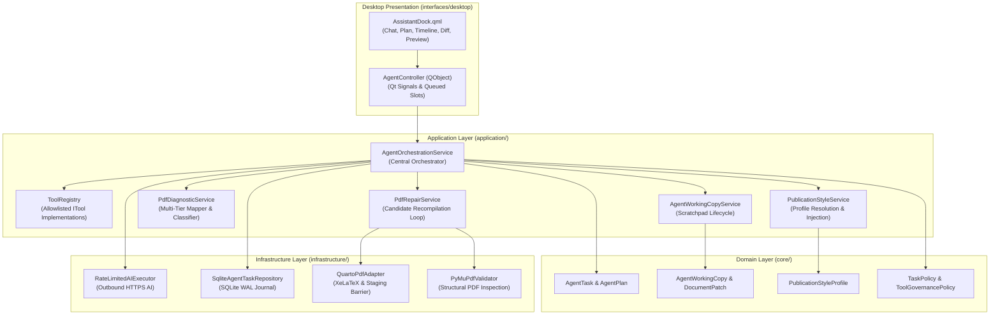
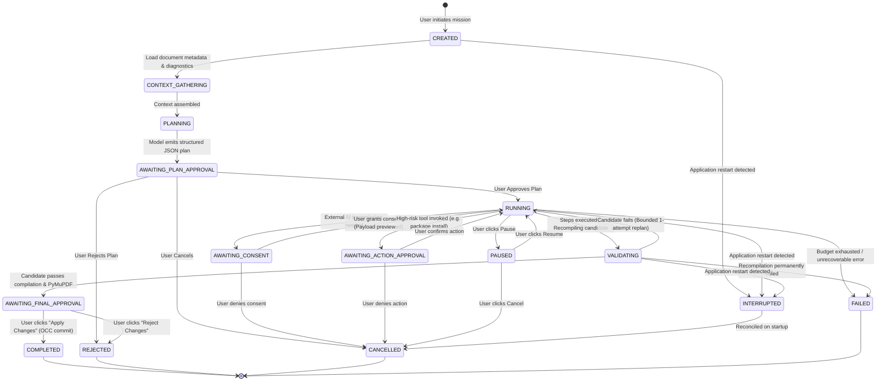
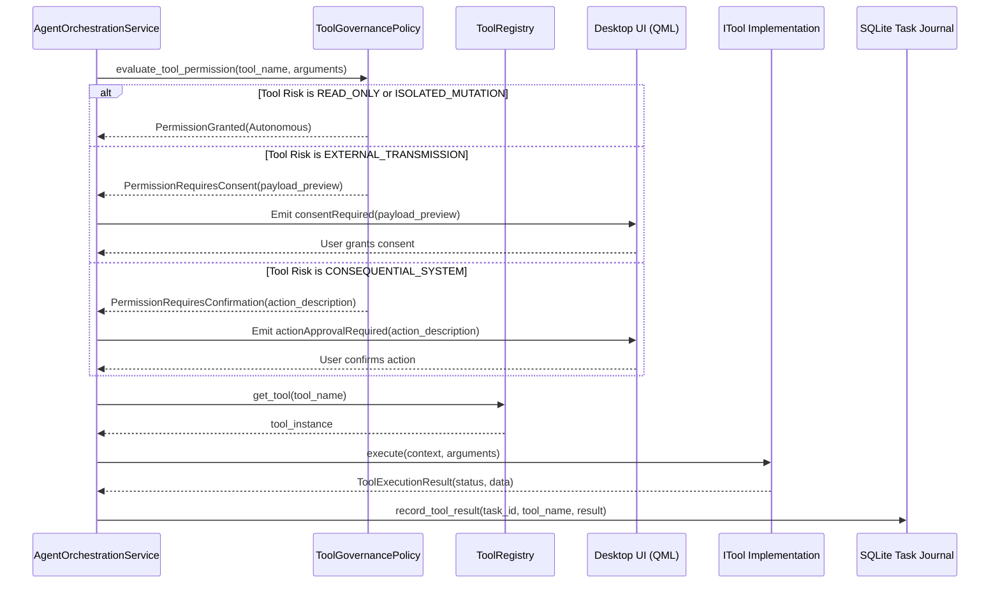
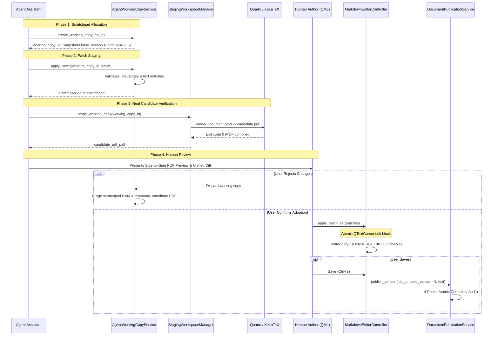
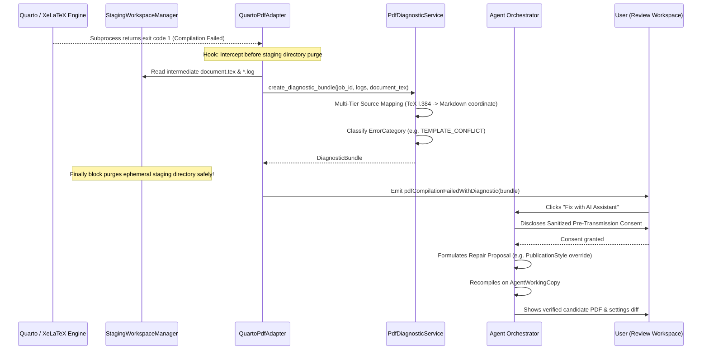
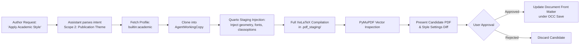
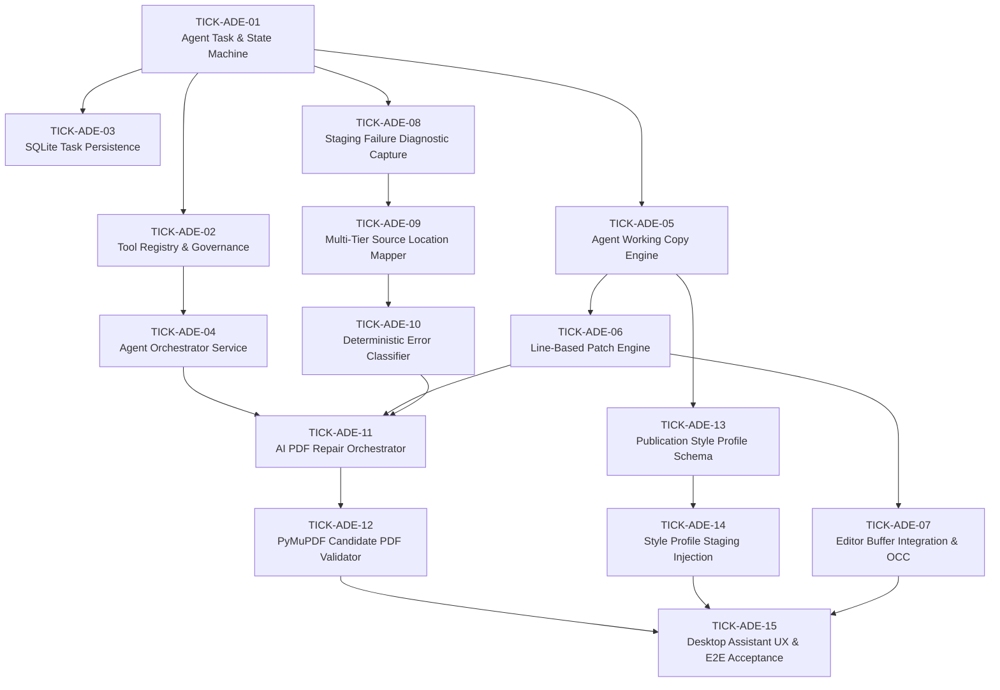

# Polpo Unified Agentic Document Engineering System: Comprehensive Architecture & Implementation Plan

- **Mission Baseline:** `25bb95d198c34c035b5d66513166e06494d82cdb` (main)
- **Release Baseline:** `v0.1.0-rc.2` (strictly preserved)
- **Date:** 2026-11-09
- **Status:** Proposed (Awaiting Maintainer Review & Approval)
- **Authoritative Directives:** D-USER-01 (Unified Assistant Scope), D-USER-02 (Supervised Agent Autonomy), D-USER-03 (Document vs Rendering-System Repair)
- **Related ADRs:** [ADR-007](file:///home/amirreza-a2a/DevelopPOlpo/PolpoT/docs/adr/2026-11-09-adr-007-unified-agent-orchestration-and-tool-governance.md), [ADR-008](file:///home/amirreza-a2a/DevelopPOlpo/PolpoT/docs/adr/2026-11-09-adr-008-agent-working-copy-patch-and-occ-safety.md), [ADR-009](file:///home/amirreza-a2a/DevelopPOlpo/PolpoT/docs/adr/2026-11-09-adr-009-quarto-export-failure-diagnostics-and-ai-pdf-repair.md), [ADR-010](file:///home/amirreza-a2a/DevelopPOlpo/PolpoT/docs/adr/2026-11-09-adr-010-publication-style-profile-system.md)
- **Research Reference:** [`docs/architecture/2026-11-09-unified-agentic-document-engineering-research.md`](file:///home/amirreza-a2a/DevelopPOlpo/PolpoT/docs/architecture/2026-11-09-unified-agentic-document-engineering-research.md)

---

## 1. Mission Statement & Executive Overview

The goal of this architectural milestone is to design and plan the implementation of the **Polpo Unified Agentic Document Engineering System**.

Polpo is an embedded, desktop-first, local-first, serverless Document Intelligence & Review Workspace. Today, Polpo incorporates isolated AI capabilities, including OCR text refinement (Pipeline 2) and single-fragment LaTeX math and diagram repair (ADR-006). This plan unifies these capabilities into a single, cohesive, supervised AI Assistant capable of multi-step document investigation, Quarto/XeLaTeX export diagnosis, formula and diagram validation, publication styling, and candidate repair generation.

Execution follows a strict **Supervised Agent** autonomy model: the assistant formulates transparent plans, investigates diagnostics autonomously within scratchpad boundaries, and re-validates candidate PDFs through the real compiler toolchain. However, external data transmission, high-risk environment changes, and canonical document modifications remain strictly gated behind deterministic application policies and explicit human review.

**Implementation is explicitly prohibited during this planning mission.** Implementation will proceed in subsequent, dedicated Boost execution sessions following maintainer review and approval of this plan, its associated ADRs, and the decomposed tickets.

---

## 2. Scope & Non-Goals

### In Scope
1. **Central Agent Orchestrator:** Provider-neutral orchestration service coordinating multi-step document engineering plans via existing `IAIExecutionService`.
2. **Allowlisted Tool Registry:** Typed, governance-controlled registry of internal document inspection, validation, styling, and patch tools.
3. **Task Lifecycle & Persistence:** State machine with checkpoints, pause/resume, cooperative cancellation, and append-only SQLite task journaling.
4. **Agent Working Copy & Patch Engine:** In-memory scratchpads tracking source hashes, line-based patches, and OCC watermarks, preventing premature canonical writes.
5. **Quarto Diagnostic Infrastructure:** Capturing intermediate generated `document.tex` and sanitized compiler logs before ephemeral staging workspace cleanup.
6. **AI-Assisted Full-Document PDF Repair:** Multi-tier source mapping, deterministic error classification, candidate recompilation, and PyMuPDF vector inspection.
7. **Publication Style Profile System:** 4-scope visual separation, declarative typography and geometry schema, 4 standard built-in profiles, and SQLite persistence for custom styles.
8. **Desktop Presentation Integration:** Assistant review drawer/dock in `ReviewWorkspaceView.qml` supporting Chat, Plan review, Execution timeline, Diff inspection, and Candidate PDF preview.

### Explicit Non-Goals
1. **No Application Backend Server:** Zero introduction of FastAPI, uvicorn, Flask, loopback HTTP ports (`127.0.0.1`), microservices, or Docker.
2. **No Unrestricted Computer Use / Shell Execution:** The Agent cannot execute arbitrary bash/cmd commands, run arbitrary Python code, or browse unrestricted filesystem paths.
3. **No Vendor-Specific Tool SDK Leaks:** Core and application layers will not import `google.generativeai`, `openai`, or vendor-proprietary function calling libraries.
4. **No Silent Canonical Persistence:** The Agent will never commit to `document_versions` or overwrite canonical Markdown without explicit user adoption under OCC.
5. **No Expansion of Telegram Transport:** The legacy Telegram bot remains frozen and untouched.
6. **No Release Tag / Baseline Alteration:** Release baseline `v0.1.0-rc.2` and commit `25bb95d` remain immutable.

---

## 3. Settled Decisions vs. Proposed Decisions

### Maintainer-Confirmed Requirements (Authoritative Directives)
- **D-USER-01 — Unified Assistant Scope:** Single unified AI Assistant coordinating multiple document-engineering tools through a shared orchestration architecture.
- **D-USER-02 — Supervised Agent Autonomy:** Supervised operating mode with multi-step plan approval, pre-transmission consent, gated high-risk actions, and explicit patch adoption.
- **D-USER-03 — Both Document and Rendering-System Repair:** Separation of document-level markup fixes, publication style configurations, preamble overrides, and product defect reports.

### Proposed Architectural Decisions (Awaiting Maintainer Approval)
- **D-PROP-01:** Provider-neutral structured JSON planning via `RateLimitedAIExecutor` (ADR-007).
- **D-PROP-02:** Isolated `AgentWorkingCopy` and line-based `PatchSet` with undo/redo preservation in editor (ADR-008).
- **D-PROP-03:** Staging failure capture of `DiagnosticBundle` (bounded log + `.tex` snippet) before workspace purge (ADR-009).
- **D-PROP-04:** Multi-tier source mapping (`EXACT_TOKEN` $\to$ `SECTION_ANCHOR` $\to$ `UNKNOWN`) (ADR-009).
- **D-PROP-05:** Versioned declarative `PublicationStyleProfile` schema with built-in profiles and allowlist staging injection (ADR-010).
- **D-PROP-06:** Append-only SQLite task journaling with safe startup recovery (`INTERRUPTED` state) (ADR-007).

---

## 4. Overall Architecture & Component Responsibility Matrix

### 4.1 Architectural Dependency Direction

```text
Presentation Layer (interfaces/desktop)
 ├── controllers/agent_controller.py             ──> Qt Presentation Adapter (Signals/Slots)
 ├── models/agent_task_presentation_model.py     ──> QObject model for QML plan & timeline
 └── qml/components/AssistantDock.qml            ──> Native QML UX (Chat, Plan, Diff, Preview)
                        │
                        ▼ (Invokes Application Services)
Application Layer (application/)
 ├── services/agent_orchestration_service.py     ──> Coordinates planning, tool calls, and state
 ├── services/tool_registry.py                   ──> Typed allowlist of executable tools
 ├── services/agent_working_copy_service.py      ──> Manages scratchpad copies and patches
 ├── services/pdf_diagnostic_service.py          ──> Classifies errors & maps TeX to Markdown
 ├── services/pdf_repair_service.py              ──> Generates candidate fixes & recompiles
 ├── services/publication_style_service.py       ──> Resolves & persists PublicationStyleProfiles
 ├── ports/agent_task_repository.py              ──> Abstract port: IAgentTaskRepository
 └── ports/pdf_validator_port.py                 ──> Abstract port: IPdfInspectionEngine
                        │
                        ▼ (Enforces Domain Policies)
Core Domain Layer (core/)
 ├── entities/agent_task.py                      ──> AgentTask, AgentPlan, PlanStep, ToolCall
 ├── entities/agent_working_copy.py              ──> AgentWorkingCopy, WorkingCopyStatus
 ├── entities/document_patch.py                  ──> DocumentPatch, PatchSet, PatchScope
 ├── entities/publication_style_profile.py       ──> PublicationStyleProfile, TypographyConfig
 ├── policies/agent_task_policy.py               ──> State machine transition rules & terminal states
 └── policies/tool_governance_policy.py          ──> ToolRiskLevel & authorization evaluations
                        ▲
                        │ (Implements Ports)
Infrastructure Layer (infrastructure/)
 ├── persistence/sqlite/agent_task_repository.py ──> SQLite WAL task & journal persistence
 ├── persistence/sqlite/style_profile_repository.py ──> SQLite publication profile persistence
 ├── pdf/quarto_adapter.py                       ──> Captures DiagnosticBundle before staging purge
 ├── pdf/staging_workspace.py                    ──> Injects profile tokens & extracts document.tex
 └── pdf/mupdf_validator.py                      ──> PyMuPDF structural & vector inspection
```

### 4.2 Component Responsibility Matrix

| Subsystem / Component | Layer | Primary Responsibility | Reused Existing Code | New Seams Introduced |
| :--- | :--- | :--- | :--- | :--- |
| `AgentTask` & `AgentPlan` | `core/` | Domain aggregate tracking task state, plan steps, and budgets. | `core/entities/job.py` | State machine & plan hierarchy. |
| `ToolGovernancePolicy` | `core/` | Evaluates tool risk levels and required authorization tokens. | — | Risk matrix & permission gate. |
| `AgentWorkingCopy` | `core/` | Scratchpad tracking base version, draft revision, text, and patches. | `core/entities/document_version.py` | Isolated scratchpad lifecycle. |
| `PublicationStyleProfile` | `core/` | Declarative schema for typography, geometry, colors, and margins. | `metadata_normalizer.py` | Publication profile schema. |
| `AgentOrchestrationService` | `application/` | Coordinates planning prompt, tool invocation, and state transitions. | `RateLimitedAIExecutor` | Task orchestration port. |
| `ToolRegistry` | `application/` | Manages allowlisted `ITool` instances, validates inputs and outputs. | `LaTeXRepairService` | Typed tool contracts. |
| `PdfDiagnosticService` | `application/` | Extracts `DiagnosticBundle`, maps TeX lines, classifies errors. | `TexLogSanitizer` | Multi-tier source mapper. |
| `PdfRepairService` | `application/` | Formulates repair prompts, coordinates working copy recompilation. | `QuartoPdfExportService` | Candidate recompilation loop. |
| `PublicationStyleService` | `application/` | Loads built-in profiles, saves custom profiles, injects metadata. | `metadata_normalizer.py` | Profile lifecycle service. |
| `SqliteAgentTaskRepository` | `infrastructure/` | Persists tasks and journal records in SQLite WAL under `BEGIN IMMEDIATE`. | `UnitOfWork` & SQLite runner | `agent_tasks`, `agent_journal` tables. |
| `QuartoPdfAdapter` | `infrastructure/` | Captures intermediate `.tex` and compiler log before purge. | `QuartoPdfAdapter` | Diagnostic extraction hook. |
| `PyMuPdfValidator` | `infrastructure/` | Inspects compiled PDF page count, text preservation, and vector drawings. | PyMuPDF (`fitz`) | `IPdfInspectionEngine` adapter. |
| `AgentController` | `interfaces/` | Translates QML user actions to service commands; exposes Qt signals. | `ExportController` & `EditorController` | Assistant presentation signals. |
| `AssistantDock.qml` | `interfaces/` | Unified UI: Chat, Plan review, Timeline, Diff, Candidate preview. | `ReviewWorkspaceView.qml` | Native desktop assistant drawer. |

---

## 5. System Architecture Diagrams

### 5.1 Overall Agent Architecture



### 5.2 Agent Task Lifecycle State Machine



### 5.3 Tool Invocation & Governance Sequence



### 5.4 Working Copy & Isolated Approval Lifecycle



### 5.5 Quarto PDF Failure Diagnostic and AI Repair Sequence



### 5.6 Publication Style Workflow



### 5.7 Implementation Dependency Graph (Ticket DAG)



---

## 6. Data Model & Persistence Strategy

### 6.1 SQLite Schema Design

In accordance with [`AGENTS.md`](file:///home/amirreza-a2a/DevelopPOlpo/PolpoT/AGENTS.md) Rules 8 & 9, schema additions are versioned, explicit, and executed through `MigrationRunner`.

```sql
-- Migration 009: Agent Task Journal and Publication Style Profiles

CREATE TABLE IF NOT EXISTS agent_tasks (
    task_id TEXT PRIMARY KEY,
    job_id INTEGER NOT NULL,
    status TEXT NOT NULL,                -- CREATED, PLANNING, AWAITING_PLAN_APPROVAL, RUNNING, etc.
    task_goal TEXT NOT NULL,
    plan_json TEXT,                     -- Serialized AgentPlan DTO
    current_step_index INTEGER DEFAULT 0,
    total_steps INTEGER DEFAULT 0,
    working_copy_id TEXT,
    failure_id TEXT,
    error_message TEXT,
    created_at REAL NOT NULL,
    updated_at REAL NOT NULL,
    FOREIGN KEY (job_id) REFERENCES jobs(id) ON DELETE CASCADE
);

CREATE INDEX IF NOT EXISTS idx_agent_tasks_job_id ON agent_tasks(job_id);
CREATE INDEX IF NOT EXISTS idx_agent_tasks_status ON agent_tasks(status);

CREATE TABLE IF NOT EXISTS agent_task_journal (
    entry_id INTEGER PRIMARY KEY AUTOINCREMENT,
    task_id TEXT NOT NULL,
    step_index INTEGER,
    event_type TEXT NOT NULL,           -- STATE_CHANGED, TOOL_CALLED, TOOL_RESULT, USER_APPROVAL, CONSENT_GRANTED
    payload_json TEXT NOT NULL,
    recorded_at REAL NOT NULL,
    FOREIGN KEY (task_id) REFERENCES agent_tasks(task_id) ON DELETE CASCADE
);

CREATE INDEX IF NOT EXISTS idx_agent_journal_task_id ON agent_task_journal(task_id);

CREATE TABLE IF NOT EXISTS publication_style_profiles (
    profile_id TEXT PRIMARY KEY,        -- "builtin:academic", "user:my_report"
    display_name TEXT NOT NULL,
    description TEXT,
    schema_version INTEGER NOT NULL DEFAULT 1,
    is_builtin INTEGER NOT NULL DEFAULT 0,
    profile_json TEXT NOT NULL,         -- Validated PublicationStyleProfile JSON
    created_at REAL NOT NULL,
    updated_at REAL NOT NULL
);
```

### 6.2 Data Minimization & Secret Prohibition
- `plan_json`, `payload_json`, and `profile_json` are strictly audited to ensure **zero plaintext API keys, passwords, or host usernames** are stored.
- Raw document text is NOT permanently stored in `agent_tasks`; text resides in canonical version files or transient `AgentWorkingCopy` RAM.

---

## 7. Allowlisted Tool Catalog

Every tool registered in `ToolRegistry` is strictly allowlisted, typed, and assigned an immutable risk level:

| Tool Name | Risk Tier | Input Parameters | Output Payload | Description |
| :--- | :--- | :--- | :--- | :--- |
| `read_document_structure` | `READ_ONLY` | `{job_id: int}` | `{headers: list, region_count: int, length: int}` | Inspects document outline and CommonMark AST blocks. |
| `inspect_diagnostic_bundle` | `READ_ONLY` | `{failure_id: str}` | `{error_category: str, tex_snippet: str, mapped_line: int, log: str}` | Reads captured compilation failure evidence. |
| `inspect_math_formulas` | `READ_ONLY` | `{job_id: int}` | `{formulas: list[dict]}` | Scans document for inline and display MathJax formulas. |
| `inspect_diagrams` | `READ_ONLY` | `{job_id: int}` | `{diagrams: list[dict]}` | Scans document for TikZ, PGFPlots, and CircuitTikZ raw blocks. |
| `get_publication_profile` | `READ_ONLY` | `{profile_id: str}` | `{profile: dict}` | Loads specified publication style profile definition. |
| `create_document_patch` | `ISOLATED_MUTATION` | `{working_copy_id: str, patch: dict}` | `{patch_id: str, success: bool}` | Staged patch against isolated `AgentWorkingCopy`. |
| `apply_patch_to_working_copy`| `ISOLATED_MUTATION`| `{working_copy_id: str, patch_id: str}`| `{new_text_sha256: str}` | Updates scratchpad text without touching disk. |
| `compile_pdf_candidate` | `ISOLATED_MUTATION` | `{working_copy_id: str}` | `{candidate_pdf_path: str, page_count: int}` | Recompiles scratchpad text in `.pdf_staging/`. |
| `request_ai_latex_repair` | `EXTERNAL_TRANSMISSION`| `{fragment: str, error_log: str}` | `{repaired_latex: str, rationale: str}` | Dispatches structured repair request to BYOK AI. |
| `request_ai_document_patch` | `EXTERNAL_TRANSMISSION`| `{context: str, instruction: str}` | `{patch_set: list[dict]}` | Requests AI to formulate document modifications. |
| `install_latex_packages` | `CONSEQUENTIAL_SYSTEM`| `{packages: list[str]}` | `{installed: list[str], failed: list[str]}` | Installs missing CTAN packages via TinyTeX manager. |
| `apply_changes_to_editor` | `CANONICAL_ADOPTION` | `{working_copy_id: str}` | `{applied_hunks: int, is_dirty: bool}` | Applies verified patches to native editor buffer. |

---

## 8. Decomposition Milestones & Ticket Index

Implementation is decomposed into 6 vertical tracer-bullet milestones comprising 15 dependency-ordered tickets. Each ticket is authored as an independent implementation specification under `.scratch/unified-agentic-document-engineering/issues/`.

### Milestone A: Agent Foundations & Orchestration Engine
*Focus: Task aggregate, state machine, allowlisted tool registry, and SQLite task persistence.*
*Recommended Implementation Skills: `domain-modeling`, `tdd`, `codebase-design`.*
- **TICK-ADE-01:** Core Domain Agent Task Aggregate, Plan Model & Lifecycle Policy.
- **TICK-ADE-02:** Allowlisted Tool Registry, Typed Tool Contracts & Risk Governance Policy.
- **TICK-ADE-03:** SQLite Task Repository, Journaling Schema & Startup Crash Recovery.
- **TICK-ADE-04:** Provider-Neutral Agent Orchestration Service & JSON Plan Generator.

### Milestone B: Working Copy & Patch Architecture
*Focus: Scratchpad isolation, line-based patch application, stale detection, and editor buffer OCC integration.*
*Recommended Implementation Skills: `tdd`, `surgical-patch`, `code-review`.*
- **TICK-ADE-05:** Agent Working Copy Aggregate, Scratchpad Lifecycle & Hash Verification.
- **TICK-ADE-06:** Raw Line-Based Document Patch Service & Collision Disambiguation.
- **TICK-ADE-07:** Native Editor Buffer Patch Adoption, Undo/Redo Integrity & OCC Gating.

### Milestone C: Quarto Diagnostic Infrastructure
*Focus: Failure diagnostic bundle capture, staging workspace hooks, multi-tier mapping, and error classification.*
*Recommended Implementation Skills: `diagnosing-bugs`, `tdd`.*
- **TICK-ADE-08:** Staging Workspace Failure Interception & Diagnostic Bundle Capture.
- **TICK-ADE-09:** Multi-Tier Generated TeX to Canonical Markdown Source Location Mapper.
- **TICK-ADE-10:** Deterministic First-Stage Error Classifier & Scope Separator.

### Milestone D: AI-Assisted PDF Repair & Recompilation Validation
*Focus: Supervised PDF repair workflow, full-document Quarto recompilation, and PyMuPDF vector inspection.*
*Recommended Implementation Skills: `tdd`, `codebase-design`.*
- **TICK-ADE-11:** AI PDF Repair Orchestration Service & Bounded Self-Correction Loop.
- **TICK-ADE-12:** PyMuPDF Structural PDF Inspection Engine & Visual Regression Validator.

### Milestone E: Publication Style Profile System
*Focus: Declarative style schema, 4 built-in profiles, SQLite persistence, and Quarto barrier injection.*
*Recommended Implementation Skills: `domain-modeling`, `tdd`.*
- **TICK-ADE-13:** Publication Style Profile Domain Schema, Built-in Templates & Validation.
- **TICK-ADE-14:** Style Profile SQLite Persistence & Staging Metadata Barrier Injection.

### Milestone F: Unified Desktop Assistant UX & E2E Integration
*Focus: Native QML assistant review dock, plan approval, diff viewer, candidate preview, and E2E verification.*
*Recommended Implementation Skills: `code-review`, `verification-before-completion`.*
- **TICK-ADE-15:** Desktop Assistant Review Dock QML, Split Candidate Preview & E2E Suite.

---

## 9. Ticket Index & Execution Matrix

| Ticket ID | Milestone | Title | Priority | Blocked By | Proposed Target Files |
| :--- | :--- | :--- | :--- | :--- | :--- |
| **`TICK-ADE-01`** | A | Core Domain Agent Task Aggregate, Plan Model & Lifecycle Policy | P1 | None | `core/entities/agent_task.py`, `core/policies/agent_task_policy.py` |
| **`TICK-ADE-02`** | A | Allowlisted Tool Registry, Typed Tool Contracts & Risk Governance Policy | P1 | `TICK-ADE-01` | `application/services/tool_registry.py`, `core/policies/tool_governance_policy.py` |
| **`TICK-ADE-03`** | A | SQLite Task Repository, Journaling Schema & Startup Crash Recovery | P1 | `TICK-ADE-01` | `infrastructure/persistence/sqlite/agent_task_repository.py`, migration runner |
| **`TICK-ADE-04`** | A | Provider-Neutral Agent Orchestration Service & JSON Plan Generator | P1 | `TICK-ADE-02`, `03` | `application/services/agent_orchestration_service.py` |
| **`TICK-ADE-05`** | B | Agent Working Copy Aggregate, Scratchpad Lifecycle & Hash Verification | P1 | `TICK-ADE-01` | `core/entities/agent_working_copy.py`, `application/services/agent_working_copy_service.py` |
| **`TICK-ADE-06`** | B | Raw Line-Based Document Patch Service & Collision Disambiguation | P1 | `TICK-ADE-05` | `core/entities/document_patch.py`, `application/services/document_patch_service.py` |
| **`TICK-ADE-07`** | B | Native Editor Buffer Patch Adoption, Undo/Redo Integrity & OCC Gating | P1 | `TICK-ADE-06` | `interfaces/desktop/controllers/markdown_editor_controller.py` |
| **`TICK-ADE-08`** | C | Staging Workspace Failure Interception & Diagnostic Bundle Capture | P1 | None | `infrastructure/pdf/quarto_adapter.py`, `infrastructure/pdf/staging_workspace.py` |
| **`TICK-ADE-09`** | C | Multi-Tier Generated TeX to Canonical Markdown Source Location Mapper | P1 | `TICK-ADE-08` | `application/services/pdf_diagnostic_service.py` |
| **`TICK-ADE-10`** | C | Deterministic First-Stage Error Classifier & Scope Separator | P1 | `TICK-ADE-08` | `application/services/pdf_diagnostic_service.py` |
| **`TICK-ADE-11`** | D | AI PDF Repair Orchestration Service & Bounded Self-Correction Loop | P1 | `TICK-ADE-04`, `06`, `10` | `application/services/pdf_repair_service.py` |
| **`TICK-ADE-12`** | D | PyMuPDF Structural PDF Inspection Engine & Visual Regression Validator | P2 | `TICK-ADE-11` | `infrastructure/pdf/mupdf_validator.py`, `application/ports/pdf_validator_port.py` |
| **`TICK-ADE-13`** | E | Publication Style Profile Domain Schema, Built-in Templates & Validation | P2 | None | `core/entities/publication_style_profile.py`, `resources/styles/*.json` |
| **`TICK-ADE-14`** | E | Style Profile SQLite Persistence & Staging Metadata Barrier Injection | P2 | `TICK-ADE-13` | `application/services/publication_style_service.py`, `staging_workspace.py` |
| **`TICK-ADE-15`** | F | Desktop Assistant Review Dock QML, Split Candidate Preview & E2E Suite | P1 | `TICK-ADE-07`, `12`, `14` | `interfaces/desktop/controllers/agent_controller.py`, `AssistantDock.qml` |

---

## 10. Definition of Done & Quality Verification

Before declaring the implementation of this system complete in subsequent Boost missions, the following criteria must be satisfied:

1. **Architecture Boundary Verification:** Static AST dependency tests pass with zero violations of Clean Architecture rules (no PySide6/Qt or vendor SDKs in `core/` or `application/`).
2. **Deterministic State Transitions:** 100% of defined `AgentTask` state transitions and terminal states verified via unit tests.
3. **OCC Safety Invariant:** Zero silent writes to SQLite `document_versions` or disk files; all document changes advance monotonically through `DocumentPublicationService`.
4. **Editor Undo/Redo Integrity:** Applied patch sets preserve the Qt `QUndoStack` and revert completely via `Ctrl+Z`.
5. **RTL Strikethrough Verification:** The mandatory `soul` reconstruction failure under XeLaTeX Persian RTL is verified to be resolved via the `ulem` publication style override without modifying the author's Markdown source.
6. **PyMuPDF Validation:** Candidate PDFs verified for page count integrity, text preservation, and vector drawing presence.
7. **Cross-Platform Test Execution:** Full test suite passing across Ubuntu Linux POSIX and Windows Server CI matrix runners.
8. **Documentation Synchronization:** ADRs, CONTEXT.md updates, and skill documentation aligned with final verified code.
