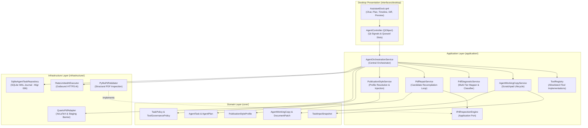
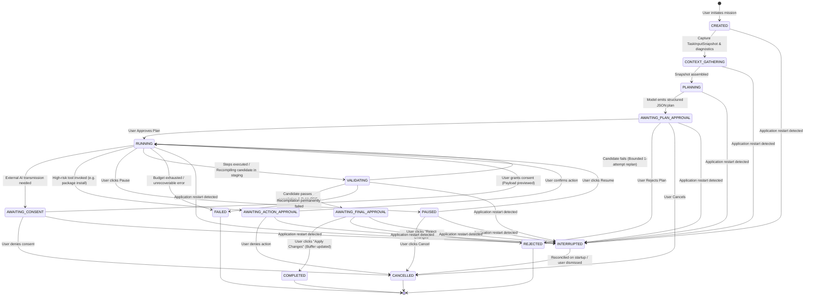
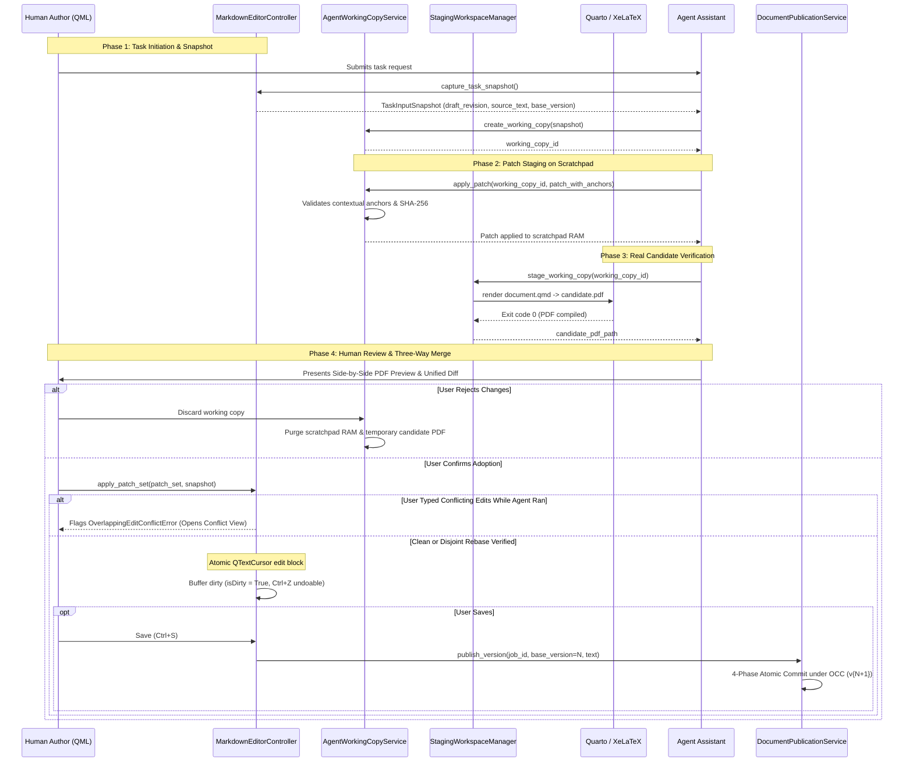
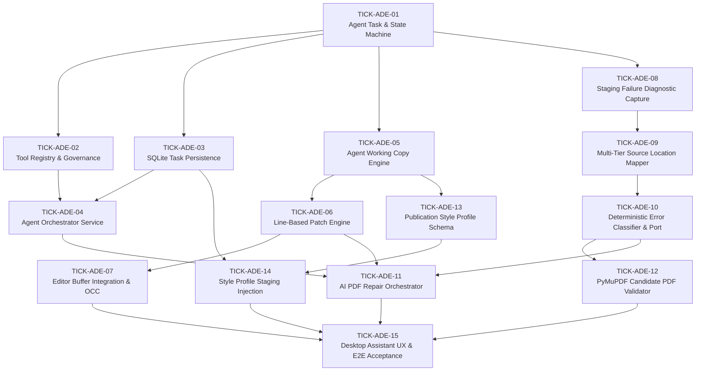

# Polpo Unified Agentic Document Engineering System: Comprehensive Architecture & Implementation Plan

- **Mission Baseline:** `25bb95d198c34c035b5d66513166e06494d82cdb` (main)
- **Release Baseline:** `v0.1.0-rc.2` (strictly preserved)
- **Date:** 2026-11-09 (Revised: 2026-11-11)
- **Status:** Proposed (Awaiting Maintainer Review & Approval)
- **Authoritative Directives:** D-USER-01 (Unified Assistant Scope), D-USER-02 (Supervised Agent Autonomy), D-USER-03 (Document vs Rendering-System Repair)
- **Related ADRs:** [ADR-007](docs/adr/2026-11-09-adr-007-unified-agent-orchestration-and-tool-governance.md), [ADR-008](docs/adr/2026-11-09-adr-008-agent-working-copy-patch-and-occ-safety.md), [ADR-009](docs/adr/2026-11-09-adr-009-quarto-export-failure-diagnostics-and-ai-pdf-repair.md), [ADR-010](docs/adr/2026-11-09-adr-010-publication-style-profile-system.md)
- **Research Reference:** [`docs/architecture/2026-11-09-unified-agentic-document-engineering-research.md`](docs/architecture/2026-11-09-unified-agentic-document-engineering-research.md)

---

## 1. Mission Statement & Executive Overview

The goal of this architectural milestone is to design and plan the implementation of the **Polpo Unified Agentic Document Engineering System**.

Polpo is an embedded, desktop-first, local-first, serverless Document Intelligence & Review Workspace. Today, Polpo incorporates isolated AI capabilities, including OCR text refinement (Pipeline 2) and single-fragment LaTeX math and diagram repair (ADR-006). This plan unifies these capabilities into a single, cohesive, supervised AI Assistant capable of multi-step document investigation, Quarto/XeLaTeX export diagnosis, formula and diagram validation, publication styling, and candidate repair generation.

Execution follows a strict **Supervised Agent** autonomy model: the assistant formulates transparent plans, investigates diagnostics autonomously within scratchpad boundaries, and re-validates candidate PDFs through the real compiler toolchain. However, external data transmission, high-risk environment changes, and canonical document modifications remain strictly gated behind deterministic application policies and explicit human review.

**Implementation is explicitly prohibited during this planning mission.** Implementation will proceed in subsequent, dedicated Boost execution sessions following maintainer review and approval of this plan, its associated ADRs, and the decomposed tickets.

---

## 2. Scope & Non-Goals

### In Scope
1. **Central Agent Orchestrator:** Provider-neutral orchestration service coordinating multi-step document engineering plans via existing `IAIExecutionService`.
2. **Allowlisted Tool Registry:** Typed, governance-controlled registry of internal document inspection, validation, styling, and patch tools.
3. **Task Lifecycle & Persistence:** State machine with checkpoints, pause/resume, cooperative cancellation, conservative crash recovery, and append-only SQLite task journaling with an explicit privacy allowlist under migration `006_agent_task_tables.sql` (Finding D, Finding E, Finding I).
4. **Agent Working Copy & Patch Engine:** In-memory scratchpads initialized from `TaskInputSnapshot`, line-based patches with stable anchors, and three-way conflict detection, preventing premature canonical writes and protecting active editor drafts (Finding C).
5. **Quarto Diagnostic Infrastructure:** Capturing intermediate generated `document.tex` locally and extracting sanitized compiler logs before ephemeral staging workspace cleanup (Finding G).
6. **AI-Assisted Full-Document PDF Repair:** Multi-tier source mapping, deterministic error classification, candidate recompilation, decoupled `IPdfInspectionEngine` port, and PyMuPDF vector inspection (Finding B, Finding H).
7. **Publication Style Profile System:** 4-scope visual separation, declarative typography and geometry schema, 4 standard built-in profiles, SQLite persistence for custom styles, and zero preamble macro injection (Finding A, Finding F).
8. **Desktop Presentation Integration:** Assistant review drawer/dock in `ReviewWorkspaceView.qml` supporting Chat, Plan review, Execution timeline, Diff inspection, and Candidate PDF preview.

### Explicit Non-Goals
1. **No Application Backend Server:** Zero introduction of FastAPI, uvicorn, Flask, loopback HTTP ports (`127.0.0.1`), microservices, or Docker.
2. **No Unrestricted Computer Use / Shell Execution:** The Agent cannot execute arbitrary bash/cmd commands, run arbitrary Python code, or browse unrestricted filesystem paths.
3. **No Vendor-Specific Tool SDK Leaks:** Core and application layers will not import `google.generativeai`, `openai`, or vendor-proprietary function calling libraries.
4. **No Silent Canonical Persistence:** The Agent will never commit to `document_versions` or overwrite canonical Markdown without explicit user adoption under OCC.
5. **No Expansion of Telegram Transport:** The legacy Telegram bot remains frozen and untouched.
6. **No Release Tag / Baseline Alteration:** Release baseline `v0.1.0-rc.2` and commit `25bb95d` remain immutable.
7. **No Arbitrary LaTeX Macro Injection:** The Agent will never inject unrestricted raw LaTeX macros or preamble code into documents or system preambles (Finding A, Finding F).

---

## 3. Settled Decisions vs. Proposed Decisions

### Maintainer-Confirmed Requirements (Authoritative Directives)
- **D-USER-01 — Unified Assistant Scope:** Single unified AI Assistant coordinating multiple document-engineering tools through a shared orchestration architecture.
- **D-USER-02 — Supervised Agent Autonomy:** Supervised operating mode with multi-step plan approval, pre-transmission consent, gated high-risk actions, and explicit patch adoption.
- **D-USER-03 — Both Document and Rendering-System Repair:** Separation of document-level markup fixes, publication style configurations, preamble overrides, and product defect reports.

### Four Open Architectural Decisions (Awaiting Explicit Maintainer Approval)
The four architectural proposals below remain explicitly unresolved and require formal maintainer sign-off:

1. **`D-PROP-01` — Tool Invocation Strategy:**
   - *Option A:* Provider-neutral structured JSON planning via `RateLimitedAIExecutor`.
   - *Option B:* Provider-native function calling encapsulated inside infrastructure adapters.
   - *Recommendation:* Option A (provider portability and fallback simplicity).
   - *Status:* `PROPOSED — AWAITING EXPLICIT MAINTAINER APPROVAL`
2. **`D-PROP-02` — Task Persistence Architecture:**
   - *Option A:* Dedicated tables (`agent_tasks`, `agent_task_journal`, `publication_style_profiles`) in `polpot.db` under Migration 006.
   - *Option B:* Separate SQLite database (`agent_tasks.db`).
   - *Recommendation:* Option A (transactional foreign-key integrity with parent jobs and unified migration runner).
   - *Status:* `PROPOSED — AWAITING EXPLICIT MAINTAINER APPROVAL`
3. **`D-PROP-06` — Publication Profile Packaging & Storage:**
   - *Option A:* Version-controlled built-in JSON assets in `resources/styles/` plus SQLite user overrides.
   - *Option B:* Database-seeded built-ins in `publication_style_profiles` table.
   - *Recommendation:* Option A (immutable git versioning of default styles and clean override precedence).
   - *Status:* `PROPOSED — AWAITING EXPLICIT MAINTAINER APPROVAL`
4. **`D-PROP-08` — Persian RTL Strikethrough Engine:**
   - *Option A:* Controlled static ULEM engine in `polpo_preamble.tex` with `[normalem]` and `\renewcommand{\st}[1]{\sout{#1}}`.
   - *Option B:* Controlled Pandoc Lua AST filter (`--lua-filter`) intercepting `Strikeout` AST elements before LaTeX emission.
   - *Recommendation:* Option A or Option B (both experimentally resolve Pandoc 3.1.3 `\st` macro definition collision; awaiting maintainer selection).
   - *Status:* `PROPOSED — AWAITING EXPLICIT MAINTAINER APPROVAL`

### Supporting Architecture Consensus Proposals
- **`D-PROP-03`:** Staging failure capture of `DiagnosticBundle` (bounded log + `.tex` snippet) before workspace purge (ADR-009, Finding G).
- **`D-PROP-04`:** Multi-tier source mapping (`EXACT_TOKEN` $\to$ `CONTEXTUAL_MATCH` $\to$ `SECTION_ANCHOR` $\to$ `UNKNOWN`) (ADR-009, Finding G).
- **`D-PROP-05`:** `TaskInputSnapshot`, isolated `AgentWorkingCopy`, and line-based `PatchSet` with three-way conflict handling and undo/redo preservation in editor (ADR-008, Finding C).
- **`D-PROP-07`:** Decoupled `IPdfInspectionEngine` foundational port in `application/ports/` before repair orchestrator, ensuring an acyclic DAG (ADR-009, Finding B).

---

## 4. Overall Architecture & Component Responsibility Matrix

### 4.1 Architectural Dependency Direction

```text
Presentation Layer (interfaces/desktop)
 ├── controllers/agent_controller.py             ──> Qt Presentation Adapter (Signals/Slots)
 ├── models/agent_task_presentation_model.py     ──> QObject model for QML plan & timeline
 └── qml/components/AssistantDock.qml            ──> Native QML UX (Chat, Plan, Diff, Preview)
                        │
                        ▼ (Invokes Application Services)
Application Layer (application/)
 ├── services/agent_orchestration_service.py     ──> Coordinates planning, tool calls, and state
 ├── services/tool_registry.py                   ──> Typed allowlist of executable tools
 ├── services/agent_working_copy_service.py      ──> Manages scratchpad copies, snapshots, and patches
 ├── services/pdf_diagnostic_service.py          ──> Classifies errors & maps TeX to Markdown
 ├── services/pdf_repair_service.py              ──> Generates candidate fixes & recompiles
 ├── services/publication_style_service.py       ──> Resolves & persists PublicationStyleProfiles
 ├── ports/agent_task_repository.py              ──> Abstract port: IAgentTaskRepository
 └── ports/pdf_validator_port.py                 ──> Abstract port: IPdfInspectionEngine (Foundation Contract)
                        │
                        ▼ (Enforces Domain Policies)
Core Domain Layer (core/)
 ├── entities/task_input_snapshot.py             ──> TaskInputSnapshot (Editor buffer baseline)
 ├── entities/agent_task.py                      ──> AgentTask, AgentPlan, PlanStep, ToolCall
 ├── entities/agent_working_copy.py              ──> AgentWorkingCopy, WorkingCopyStatus
 ├── entities/document_patch.py                  ──> DocumentPatch, PatchSet, PatchAnchor, PatchScope
 ├── entities/publication_style_profile.py       ──> PublicationStyleProfile, TypographyConfig
 ├── policies/agent_task_policy.py               ──> State machine transition rules & terminal states
 └── policies/tool_governance_policy.py          ──> ToolRiskLevel & authorization evaluations
                        ▲
                        │ (Implements Ports)
Infrastructure Layer (infrastructure/)
 ├── persistence/sqlite/agent_task_repository.py ──> SQLite WAL task & journal persistence (Migration 006)
 ├── persistence/sqlite/style_profile_repository.py ──> SQLite publication profile persistence (Migration 006)
 ├── pdf/quarto_adapter.py                       ──> Captures DiagnosticBundle before staging purge
 ├── pdf/staging_workspace.py                    ──> Injects profile tokens & extracts document.tex
 └── pdf/mupdf_validator.py                      ──> PyMuPdfValidator (implements IPdfInspectionEngine)
```

### 4.2 Component Responsibility Matrix

| Subsystem / Component | Layer | Primary Responsibility | Reused Existing Code | New Seams Introduced |
| :--- | :--- | :--- | :--- | :--- |
| `TaskInputSnapshot` | `core/` | Freezes editor draft text, canonical version, and revisions at task initiation. | `core/entities/job.py` | Editor snapshot model. |
| `AgentTask` & `AgentPlan` | `core/` | Domain aggregate tracking task state, plan steps, and budgets. | `core/entities/job.py` | State machine & plan hierarchy. |
| `ToolGovernancePolicy` | `core/` | Evaluates tool risk levels and required authorization tokens. | — | Risk matrix & permission gate. |
| `AgentWorkingCopy` | `core/` | Scratchpad tracking base version, draft revision, text, and patches. | `core/entities/document_version.py` | Isolated scratchpad lifecycle. |
| `PublicationStyleProfile` | `core/` | Declarative schema for typography, geometry, colors, and margins. | `metadata_normalizer.py` | Publication profile schema. |
| `IPdfInspectionEngine` | `application/ports/` | Abstract contract for structural and visual PDF inspection. | `application/ports/pdf_export_port.py` | Foundational validator port. |
| `AgentOrchestrationService` | `application/` | Coordinates planning prompt, tool invocation, and state transitions. | `RateLimitedAIExecutor` | Task orchestration port. |
| `ToolRegistry` | `application/` | Manages allowlisted `ITool` instances, validates inputs and outputs. | `LaTeXRepairService` | Typed tool contracts. |
| `PdfDiagnosticService` | `application/` | Extracts `DiagnosticBundle`, maps TeX lines, classifies errors. | `TexLogSanitizer` | Multi-tier source mapper. |
| `PdfRepairService` | `application/` | Formulates repair prompts, coordinates working copy recompilation. | `QuartoPdfExportService` | Candidate recompilation loop. |
| `PublicationStyleService` | `application/` | Loads built-in profiles, saves custom profiles, injects metadata. | `metadata_normalizer.py` | Profile lifecycle service. |
| `SqliteAgentTaskRepository` | `infrastructure/` | Persists tasks and allowlisted journal records in SQLite WAL under `BEGIN IMMEDIATE`. | `UnitOfWork` & SQLite runner | Migration `006_agent_task_tables.sql`. |
| `QuartoPdfAdapter` | `infrastructure/` | Captures intermediate `.tex` and compiler log before purge. | `QuartoPdfAdapter` | Diagnostic extraction hook. |
| `PyMuPdfValidator` | `infrastructure/` | Inspects compiled PDF page count, text preservation, and vector drawings. | PyMuPDF (`fitz`) | `IPdfInspectionEngine` adapter. |
| `AgentController` | `interfaces/` | Translates QML user actions to service commands; exposes Qt signals. | `ExportController` & `EditorController` | Assistant presentation signals. |
| `AssistantDock.qml` | `interfaces/` | Unified UI: Chat, Plan review, Timeline, Diff, Candidate preview. | `ReviewWorkspaceView.qml` | Native desktop assistant drawer. |

---

## 5. System Architecture Diagrams

### 5.1 Overall Agent Architecture



### 5.2 Agent Task Lifecycle State Machine (Finding D)



### 5.3 Working Copy, Snapshot & Three-Way Conflict Lifecycle (Finding C)



### 5.4 Corrected Ticket Dependency DAG (Finding B)



#### Topological Order & Milestone Feasibility:
1. **Milestone A (Agent Foundations):**
   - TICK-ADE-01 (Domain Task & Policy) $\to$ TICK-ADE-02 (Tool Registry) & TICK-ADE-03 (SQLite Persistence under Migration 006) $\to$ TICK-ADE-04 (Orchestrator Service).
2. **Milestone B (Working Copy & Patch Safety):**
   - TICK-ADE-05 (Working Copy & `TaskInputSnapshot`) $\to$ TICK-ADE-06 (Line Patch with Anchors) $\to$ TICK-ADE-07 (Editor Buffer Adoption & OCC).
3. **Milestone C (Quarto Diagnostic Infrastructure):**
   - TICK-ADE-08 (Failure Interception & Bundle) $\to$ TICK-ADE-09 (Multi-Tier Source Mapper) $\to$ TICK-ADE-10 (Error Classifier & `IPdfInspectionEngine` Foundation Port).
4. **Milestone D (AI-Assisted PDF Repair):**
   - TICK-ADE-10 provides the `IPdfInspectionEngine` port.
   - TICK-ADE-12 implements `PyMuPdfValidator` conforming to `IPdfInspectionEngine`.
   - TICK-ADE-11 implements `PdfRepairService` orchestrating repair candidates and calling `IPdfInspectionEngine`.
   - TICK-ADE-11 and TICK-ADE-12 are acyclic and can be executed in topological sequence or parallel.
5. **Milestone E (Publication Style System):**
   - TICK-ADE-13 (Profile Schema & Built-in JSONs) $\to$ TICK-ADE-14 (SQLite Persistence & Metadata Injection).
6. **Milestone F (Desktop Assistant UX & Capabilities):**
   - TICK-ADE-15 (QML Assistant Dock, Diff Viewer, Candidate Preview, and E2E Test Suite) unifies Milestones A through E.

---

## 6. Persistence Strategy & Journal Privacy (Finding E, Finding I)

### 6.1 Unified SQLite Schema Migration: `006_agent_task_tables.sql`

In accordance with actual repository state (`main` contains migrations 001 through 005), migration 006 defines all Agent and Style Profile tables:

```sql
-- infrastructure/persistence/sqlite/migrations/006_agent_task_tables.sql
-- Migration 006: Agent Tasks, Allowlisted Journal, and Publication Style Profiles

CREATE TABLE IF NOT EXISTS agent_tasks (
    task_id TEXT PRIMARY KEY,
    job_id INTEGER NOT NULL,
    status TEXT NOT NULL,
    task_goal TEXT NOT NULL,
    plan_json TEXT,
    current_step_index INTEGER DEFAULT 0,
    total_steps INTEGER DEFAULT 0,
    working_copy_id TEXT,
    failure_id TEXT,
    error_message TEXT,
    created_at REAL NOT NULL,
    updated_at REAL NOT NULL,
    completed_at REAL,
    FOREIGN KEY (job_id) REFERENCES jobs(id) ON DELETE CASCADE
);

CREATE INDEX IF NOT EXISTS idx_agent_tasks_job_id ON agent_tasks(job_id);
CREATE INDEX IF NOT EXISTS idx_agent_tasks_status ON agent_tasks(status);

CREATE TABLE IF NOT EXISTS agent_task_journal (
    entry_id INTEGER PRIMARY KEY AUTOINCREMENT,
    task_id TEXT NOT NULL,
    step_index INTEGER,
    event_type TEXT NOT NULL,
    metadata_json TEXT NOT NULL,
    recorded_at REAL NOT NULL,
    FOREIGN KEY (task_id) REFERENCES agent_tasks(task_id) ON DELETE CASCADE
);

CREATE INDEX IF NOT EXISTS idx_agent_journal_task_id ON agent_task_journal(task_id);

CREATE TABLE IF NOT EXISTS publication_style_profiles (
    profile_id TEXT PRIMARY KEY,
    display_name TEXT NOT NULL,
    description TEXT,
    schema_version INTEGER NOT NULL DEFAULT 1,
    is_builtin INTEGER NOT NULL DEFAULT 0,
    profile_json TEXT NOT NULL,
    created_at REAL NOT NULL,
    updated_at REAL NOT NULL
);
```

### 6.2 Task Journal Privacy Governance & Persistent Field Policy (Finding A)
- **Persist Lifecycle Metadata, Not Document Content:** Prohibit storing raw user requests containing source fragments, full Markdown drafts, working copies, prompts, completions, unredacted compiler diagnostics, credentials, or filesystem paths.
- **`task_goal` Definition:** Short display label / classification only (max 256 chars, sanitized). Never store the user's raw prompt directly if it contains document or private content.
- **`plan_json` Schema:** Validated machine-readable JSON against `AgentPlanSchema` with allowlisted keys and bounded size (max 16 KB). Prohibit unvalidated model-generated payloads or document fragments.
- **`error_message` Policy:** Sanitized English diagnostic category or bounded summary (max 512 chars) stripped of paths and stack traces.
- **Journal `metadata_json` Allowlist:** `task_id`, `step_index`, `event_type`, `recorded_at`, `duration_ms`, `tool_name`, `step_correlation_id` (opaque UUID replacing plain hashes), `status`, `sanitized_error_category`, `consent_token_ref` (single-use UUID reference), `approval_token_ref` (single-use UUID reference), `summary` (generic non-sensitive status <= 256 chars), `request_disposition`.
- Entries capped at 8 KB; tasks capped at 50 journal entries.

### 6.3 Task Retention, Purging, and Deletion Semantics (Finding E)
- **Retention Baseline:** 30-day retention calculated strictly from `completed_at` (terminal transition time), NOT task creation time.
- **Scope:** Applies to all terminal states (`COMPLETED`, `REJECTED`, `CANCELLED`, `FAILED`, `INTERRUPTED`). Active or awaiting tasks are never automatically purged.
- **Cascade Deletion:** SQLite `ON DELETE CASCADE` automatically cleans up associated `agent_task_journal` rows.
- **Two-Phase Idempotent Filesystem Cleanup:**
  1. Purge scratchpad directories (`.polpo/working_copies/{id}/`) and staging failure bundles (`.polpo/staging_failures/{id}/`) using idempotent unlinks.
  2. Delete database records in a SQLite transaction (`BEGIN IMMEDIATE`) with bounded batch limits (`LIMIT 50`).
  3. Startup reconciliation cleans orphan scratchpad directories whose `working_copy_id` is missing in `agent_tasks`.

---

## 7. Allowlisted Tool Catalog

| Tool Name | Risk Tier | Input Parameters | Output Payload | Description |
| :--- | :--- | :--- | :--- | :--- |
| `read_document_structure` | `READ_ONLY` | `{job_id: int}` | `{headers: list, region_count: int, length: int}` | Inspects document outline and CommonMark AST blocks. |
| `inspect_diagnostic_bundle` | `READ_ONLY` | `{failure_id: str}` | `{error_category: str, tex_snippet: str, mapped_line: int, log: str}` | Reads captured compilation failure evidence. |
| `inspect_math_formulas` | `READ_ONLY` | `{job_id: int}` | `{formulas: list[dict]}` | Scans document for inline and display MathJax formulas. |
| `inspect_diagrams` | `READ_ONLY` | `{job_id: int}` | `{diagrams: list[dict]}` | Scans document for TikZ, PGFPlots, and CircuitTikZ raw blocks. |
| `get_publication_profile` | `READ_ONLY` | `{profile_id: str}` | `{profile: dict}` | Loads specified publication style profile definition. |
| `create_document_patch` | `ISOLATED_MUTATION` | `{working_copy_id: str, patch: dict}` | `{patch_id: str, success: bool}` | Staged patch against isolated `AgentWorkingCopy`. |
| `apply_patch_to_working_copy`| `ISOLATED_MUTATION`| `{working_copy_id: str, patch_id: str}`| `{new_text_sha256: str}` | Updates scratchpad text without touching disk. |
| `compile_pdf_candidate` | `ISOLATED_MUTATION` | `{working_copy_id: str}` | `{candidate_pdf_path: str, page_count: int}` | Recompiles scratchpad text in `.pdf_staging/`. |
| `request_ai_latex_repair` | `EXTERNAL_TRANSMISSION`| `{fragment: str, error_log: str}` | `{repaired_latex: str, rationale: str}` | Dispatches structured repair request to BYOK AI. |
| `request_ai_document_patch` | `EXTERNAL_TRANSMISSION`| `{context: str, instruction: str}` | `{patch_set: list[dict]}` | Requests AI to formulate document modifications. |
| `install_latex_packages` | `CONSEQUENTIAL_SYSTEM`| `{packages: list[str]}` | `{installed: list[str], failed: list[str]}` | Installs missing CTAN packages via TinyTeX manager. |
| `apply_changes_to_editor` | `CANONICAL_ADOPTION` | `{working_copy_id: str}` | `{applied_hunks: int, is_dirty: bool}` | Applies verified patches to native editor buffer. |

---

## 8. Milestone Execution & Acceptance Gates

### Milestone A — Agent Foundations
- **Tickets:** `TICK-ADE-01`, `TICK-ADE-02`, `TICK-ADE-03`, `TICK-ADE-04`.
- **Deliverables:** Core domain `AgentTask` aggregate, policy, allowlisted `ToolRegistry`, SQLite persistence under migration `006_agent_task_tables.sql`, and `AgentOrchestrationService`.
- **Exit Gate:** 100% unit tests pass; all non-terminal states marked `INTERRUPTED` on simulated restart; old authorization tokens invalidated; unknown network outcomes require explicit human confirmation (zero auto-retry); negative database privacy tests pass across all tables; zero vendor SDK leaks.

### Milestone B — Working Copy and Patch Safety
- **Tickets:** `TICK-ADE-05`, `TICK-ADE-06`, `TICK-ADE-07`.
- **Deliverables:** `TaskInputSnapshot`, `AgentWorkingCopy`, line patch engine with stable anchors, three-way conflict detection, atomic `QTextCursor` editor adoption, and OCC save gating.
- **Exit Gate:** Applying patches preserves editor undo stack (`Ctrl+Z`); uncommitted edits are protected; zero premature disk writes.

### Milestone C — Diagnostics & Inspection Contracts
- **Tickets:** `TICK-ADE-08`, `TICK-ADE-09`, `TICK-ADE-10`.
- **Deliverables:** Staging failure capture, multi-tier source location mapper, fail-closed error classifier (`UNKNOWN -> None` scope with 0.0 confidence, `PACKAGE_MISSING` routed to `ENVIRONMENT_DEPENDENCY`), and the foundational `IPdfInspectionEngine` application port with `require_vector_drawings = False` by default and minimized inspection DTO.
- **Exit Gate:** XeLaTeX error lines map accurately to Markdown; `Package soul Error: Reconstruction failed.` classified as `TEMPLATE_CONFLICT`; unknown errors halt automated patching; `IPdfInspectionEngine` port ready.

### Milestone D — PDF Repair & Validation
- **Tickets:** `TICK-ADE-11`, `TICK-ADE-12`.
- **Deliverables:** `PdfRepairService` (bounded self-correction loop) and `PyMuPdfValidator` (structural and vector PDF inspection, separated from visual quality claims).
- **Exit Gate:** Broken XeLaTeX compilation repaired via typed style profile override (`strikethrough_engine = "ulem"`); candidate validated through PyMuPDF; text-only PDFs pass without vector drawings; zero arbitrary LaTeX macro injection; D-PROP-08 awaiting maintainer approval.

### Milestone E — Publication Styles
- **Tickets:** `TICK-ADE-13`, `TICK-ADE-14`.
- **Deliverables:** 4-scope visual separation, `PublicationStyleProfile` schema, 4 built-in JSON profiles in `resources/styles/`, SQLite persistence, and staging metadata injection.
- **Exit Gate:** All 4 built-in profiles compile cleanly under XeLaTeX; missing fonts fall back safely; raw TeX injection rejected.

### Milestone F — Desktop Assistant UX & E2E Acceptance
- **Tickets:** `TICK-ADE-15`.
- **Deliverables:** `AgentController`, `AssistantDock.qml`, plan review card, diff inspector, split candidate PDF preview, and end-to-end headless integration suite.
- **Exit Gate:** Full end-to-end acceptance suite passes offscreen (`QQuickView.grabWindow()`); no GUI thread blocking; responsive cancellation.
