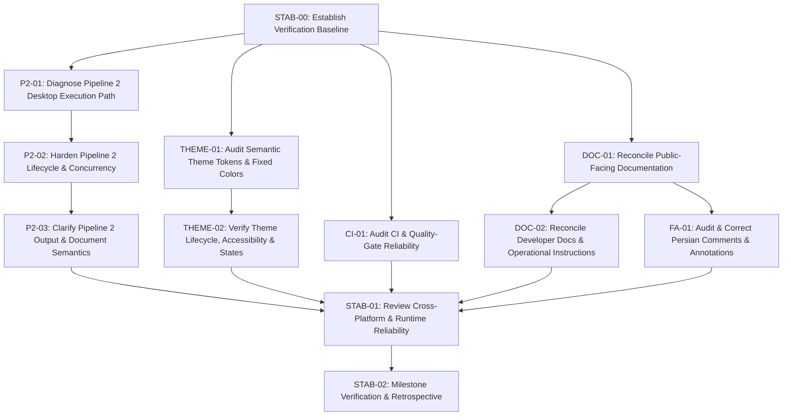
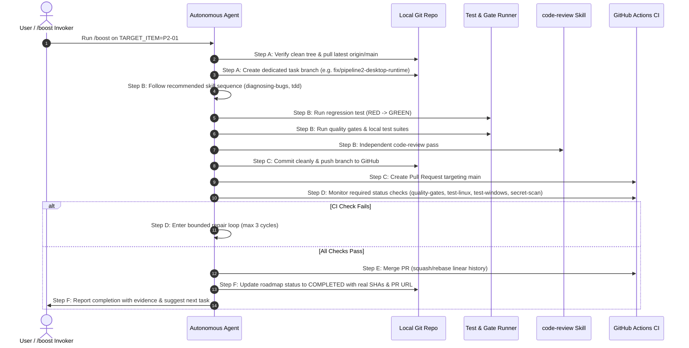

# Polpo Stabilization Roadmap and Autonomous Agent Workflow

**Document:** `docs/quality/stabilization-roadmap.md`
**Repository:** `amirreza-a2a/Polpo`
**Working Directory:** `/home/amirreza-a2a/DevelopPOlpo/PolpoT`
**Primary Branch:** `main`
**Baseline Creation Date:** 2026-10-21
**Status:** ACTIVE SINGLE SOURCE OF TRUTH (Planning & Execution Protocol)

---

## 1. Mission Purpose and Release-Freeze Policy

### 1.1 Mission Objective

The purpose of this document is to establish a persistent, rigorous, and verifiable stabilization roadmap for the Polpo desktop application. It unifies all stabilization initiatives—including runtime verification, Pipeline 2 execution investigation, theme system validation, public and developer documentation reconciliation, Persian comment hygiene, continuous integration reliability, and runtime cross-platform safety.

This document serves as the **single source of truth** for stabilization. Future agent sessions (including automated `/boost` sessions) must execute exactly one scoped work item at a time, verify it against explicit acceptance criteria and automated CI gates, record the outcome with dated evidence, update the backlog state, and identify the next candidate task without expanding scope.

### 1.2 Mandatory Release Freeze

> [!IMPORTANT]
> **Release Freeze Active:** The maintainer has explicitly decided to postpone publication while stabilizing and hardening the application.
>
> Under this initiative, the following actions are **strictly prohibited** until the maintainer grants explicit, written authorization:
> - Creating, pushing, or moving release tags (e.g. `v0.1.0`, `v0.1.1`, `v1.0.0`).
> - Publishing or drafting a GitHub Release.
> - Publishing or uploading release assets to GitHub Releases.
> - Altering the default release channels in the application or installer (the stable channel remains unpublished).
> - Incrementing or changing the authoritative release version in `core/version.py` or `pyproject.toml` solely to stage or prepare publication.
> - Claiming in documentation, pull requests, or commits that a stable release has been published.
>
> Release workflows (`.github/workflows/release.yml`) may be audited, tested, or validated in dry-run mode (`workflow_dispatch`), but publication must remain gated and inhibited.

---

## 2. Verified Repository Baseline & Dated Evidence Snapshot

*Initial Roadmap Baseline Snapshot: 2026-10-21 14:22 UTC+03:30 (Commit `9b8c54e`, PR #122)*<br/>
*STAB-00 Verified Execution Baseline Snapshot: 2026-10-22 00:15 UTC+03:30 (Commit `b9b7141`, PR #133)*<br/>
*P2-03 Verified Execution Snapshot: 2026-10-22 12:25 UTC+03:30 (Commit `ec5854f`, PR #137)*<br/>
*THEME-02 Verified Execution Snapshot: 2026-10-23 01:10 UTC+03:30 (Commit `3d71f98`, PR #143)*<br/>
*DOC-01 Historical Implementation Snapshot: 2026-10-23 14:35 UTC+03:30 (Commit `c7181a5`, PR #145)*<br/>
*DOC-01 Verified Closeout Snapshot: 2026-10-23 15:06 UTC+03:30 (Commit `5a9d8b6`, PR #146)*<br/>
*DOC-02 Verified Execution Snapshot: 2026-10-28 14:18 UTC+03:30 (Commit `515fd05`, PR #147)*

### 2.1 Git and Working Tree State

| Property | Verified Value | Evidence Source |
| :--- | :--- | :--- |
| **Active Baseline Branch** | `main` | `git status` |
| **HEAD Commit SHA (main)** | `515fd05317b661f42e32041d315aaaf72dc22f72` | `git rev-parse HEAD` |
| **Commit Message** | `docs: reconcile developer documentation, glossary, and skill routing (DOC-02) (#147)` | `git log -1` |
| **Remote Synchronization** | Up to date with `origin/main` | `git status -sb` |
| **Working Tree Status** | Clean (no modified, untracked, or staged files) | `git status --porcelain` |
| **Latest Git Tag** | `v0.1.0-rc.1` | `git tag -l` |
| **Git Describe** | `v0.1.0-rc.1-29-g515fd05` | `git describe --tags --always` |
| **GitHub Releases** | Exactly 1 Pre-release: `v0.1.0-rc.1` (Zero stable releases published) | `gh release list` |
| **Application Version** | `APP_NAME = "Polpo"`, `__version__ = "0.1.0"`, `VERSION_INFO = (0, 1, 0)` | `core/version.py:9-11`, `pyproject.toml:7` |

### 2.2 Branch Protection & Merge-Gating Invariants

The `main` branch is protected by GitHub Classic Branch Protection (`docs/ci-repository-rules.md`). The live REST API configuration was directly verified via `gh api repos/amirreza-a2a/Polpo/branches/main/protection`:

- **Strict Status Checks (`strict: true`):** Pull request branches must be strictly up to date with the latest commit on `main` before merging.
- **Enforce Administrators (`enforce_admins: true`):** Administrators cannot bypass status checks or linear history.
- **Linear History Required (`required_linear_history: true`):** Standard merge commits are blocked; only squash-and-merge or rebase-and-merge are permitted.
- **Force Pushes Forbidden (`allow_force_pushes: false`):** Force pushes are rejected by the server.
- **Deletions Forbidden (`allow_deletions: false`):** Deleting `main` is blocked.
- **Required Pull Request Reviews (`required_pull_request_reviews: null`):** Merge eligibility is automated via CI status checks without requiring manual human review counts.
- **Required Status Checks (Exact 4 Contexts):**
  1. `quality-gates`
  2. `test-linux`
  3. `test-windows`
  4. `secret-scan`

### 2.3 Continuous Integration Verification Status

Verified from GitHub Actions run `39598309337` (triggered on push to `main` at commit `55fd3d5`):

| Check / Job Name | Runner Environment | Outcome | Duration | Notes / Evidence |
| :--- | :--- | :--- | :--- | :--- |
| `quality-gates` | `ubuntu-24.04` (Python 3.12) | **PASSED** | 37s | Whitespace check, bytecode compilation across 5 packages, 48 AST architecture invariant tests. |
| `secret-scan` | `ubuntu-24.04` | **PASSED** | 11s | Gitleaks Action (`v3.0.0`, SHA `e0c47f4f...`), 0 leaks detected. |
| `test-linux` | `ubuntu-24.04` (Python 3.12, offscreen Qt) | **PASSED** | 1m 43s | **2050 passed, 13 skipped, 2 warnings in 60.07s** (2063 total collected). |
| `test-windows` | `windows-2025` (Python 3.12, offscreen Qt) | **PASSED** | 5m 14s | **2013 passed, 50 skipped, 2 warnings in 198.63s** (2063 total collected). |

*(Historical reference: Previous run `39494645119` on commit `9b8c54e` also passed all 4 checks: quality-gates 56s, secret-scan 9s, test-linux 1m 51s, test-windows 3m 50s).*

*Known CI Annotations:* GitHub Actions emitted deprecation notices for Node.js 20 targeting in `actions/cache@v4.2.2` and `actions/setup-node@v4.2.0`, currently forced to run on Node.js 24 on runners.

### 2.4 Local Verification Environment (Linux Tier-1 Reference Host)

Verified on local workstation host environment under `./.venv`:

- **Operating System:** Linux C137 `7.0.0-38-generic #38~24.04.4-Ubuntu SMP PREEMPT_DYNAMIC` x86_64 (`Ubuntu 24.04.5 LTS (Noble Numbat)`).
- **Python Environment:** `./.venv/bin/python` (Python 3.12.3), pytest 9.1.1, pip 24.0, PySide6 6.8.0.2.
- **Node & NPM:** Node.js v22.23.2, npm 10.9.8.
- **System Document Tools on PATH:** System Pandoc 3.1.3 (`/usr/bin/pandoc`), Quarto 1.9.38 (`/usr/local/bin/quarto`), XeLaTeX (`XeTeX 3.141592653-2.6-0.999995 TeX Live 2023/Debian`), actionlint (`/home/amirreza-a2a/go/bin/actionlint`).
- **Project-Bundled Standalone Runtimes:**
  - Bundled Pandoc: `resources/bin/linux-x86_64/pandoc` (version 3.1.11, matches `resources/runtimes.json`).
  - Bundled Node: `resources/mathjax/node` (version v22.23.2, matches `resources/runtimes.json`).
  - Headless MathJax Worker: 8/8 contract checks verified passing via `python scripts/verify_mathjax_worker.py` (MathJax 3.2.2).
- **Quality Gates Execution:**
  - Command: `QT_QPA_PLATFORM=offscreen QSG_RHI_BACKEND=software ./.venv/bin/python scripts/run_quality_gates.py --mode=working-tree`
  - Outcome: **PASSED (exit code 0)** in 3.63s.
  - Scope: Whitespace check clean, Python bytecode compilation across `core`, `application`, `infrastructure`, `interfaces`, `tests` clean, 55 AST architecture invariant tests passed.
- **Independent Test Suite Executions:**
  - **Unit Tests:** `QT_QPA_PLATFORM=offscreen QSG_RHI_BACKEND=software ./.venv/bin/python -m pytest tests/unit/ -q -rs`
    - Outcome: **2081 passed, 0 skipped, 2 warnings, 37 subtests passed in 82.23s** (exit code 0).
  - **Characterization Tests:** `QT_QPA_PLATFORM=offscreen QSG_RHI_BACKEND=software ./.venv/bin/python -m pytest tests/characterization/ -q -rs`
    - Outcome: **32 passed, 0 skipped in 0.44s** (exit code 0).
  - **Integration Tests:** `QT_QPA_PLATFORM=offscreen QSG_RHI_BACKEND=software ./.venv/bin/python -m pytest tests/integration/ -q -rs`
    - Outcome: **77 passed, 6 skipped in 29.98s** (exit code 0, 83 collected items).
  - **Complete Test Suite:** `QT_QPA_PLATFORM=offscreen QSG_RHI_BACKEND=software ./.venv/bin/python -m pytest tests/ -q -rs`
    - Outcome: **2190 passed, 6 skipped, 2 warnings, 37 subtests passed in 107.19s** (exit code 0, 2196 total collected items).
- **Observed Warnings (2 ResourceWarnings):**
  - `tests/unit/test_ai_adapters.py:46`: `ResourceWarning: unclosed file <.../core/ai/types.py>`
  - `tests/unit/test_ai_adapters.py:46`: `ResourceWarning: unclosed file <.../core/ai/exceptions.py>`
  *(Present in both local and CI test runs; benign static file read without explicit context manager in test helper).*

### 2.5 Cross-Platform Skip Classification Matrix

A full AST audit and log reconciliation verified all 2063 test items across local Linux, CI Linux, and CI Windows:

| # | Test Identifier / Module | Skip Reason & Condition | Local Linux | CI Linux | CI Windows | Category |
| :- | :--- | :--- | :-: | :-: | :-: | :--- |
| 1–6 | `tests/integration/test_windows_process_tree.py` (6 tests: timeout, cancellation, lingering root exit, assignment failure, cleanup, concurrent launch) | `Windows Job Object integration tests require Windows platform` (`sys.platform != 'win32'`) | **SKIPPED** | **SKIPPED** | **PASSED** | OS Platform (Windows-only) |
| 7–9 | `tests/integration/test_quarto_pdf_export_e2e.py` (3 live compilation tests: #71 bilingual Persian RTL & TikZ, #72 KaTeX math, #76 Persian RTL callouts & 4-dash regression) | `Quarto or XeLaTeX not available on host` (`not is_quarto_installed()`) | **PASSED** | **SKIPPED** | **SKIPPED** | Optional Host Tooling (Quarto/XeLaTeX) |
| 10 | `tests/unit/test_pandoc_binary.py::test_real_system_pandoc_integration` | `Pandoc not installed on test host` (`shutil.which("pandoc") is None`) | **PASSED** | **SKIPPED** | **SKIPPED** | Optional Host Tooling (System Pandoc) |
| 11 | `tests/unit/test_pandoc_runner.py::test_real_system_pandoc_runner_integration` | `Pandoc not installed on test host` (`shutil.which("pandoc") is None`) | **PASSED** | **SKIPPED** | **SKIPPED** | Optional Host Tooling (System Pandoc) |
| 12 | `tests/unit/test_release_workflow_contract.py::TestReleaseWorkflowContract::test_actionlint_validation` | `actionlint executable not found in PATH` (`shutil.which("actionlint") is None`) | **PASSED** | **SKIPPED** | **SKIPPED** | Optional Host Tooling (actionlint) |
| 13 | `tests/unit/test_sqlite_persistence.py::TestSQLitePersistence::test_real_desktop_app_database_upgrades_cleanly` | `Real desktop database does not exist on this environment.` (`not ~/.local/share/polpot/polpot.db exists`) | **PASSED** | **SKIPPED** | **SKIPPED** | Local State (User DB) |
| 14–36 | `tests/unit/test_linux_installer.py` (23 tests: install, upgrade, rollback, uninstall, archive safety, checksums, distro checks) | `Linux installer tests require a Linux environment` (`sys.platform != 'linux'`) | **PASSED** | **PASSED** | **SKIPPED** | OS Platform (Linux-only) |
| 37–49 | `tests/unit/test_polpo_deps.py` (13 tests: distro detection, GUI dry runs, package manager fallbacks) | `Linux dependency helper tests require a Linux environment` (`sys.platform != 'linux'`) | **PASSED** | **PASSED** | **SKIPPED** | OS Platform (Linux-only) |
| 50 | `tests/unit/test_legacy_data_migration.py::test_get_user_data_dir_respects_xdg_data_home` | `XDG_DATA_HOME is honored only on Linux/POSIX per ADR-003 and AGENTS.md` (`sys.platform.startswith(('win', 'darwin'))`) | **PASSED** | **PASSED** | **SKIPPED** | OS Platform (POSIX-only) |
| 51 | `tests/unit/test_mathjax_worker_headless.py::test_subprocess_clean_exit_on_sigterm` | `SIGTERM is POSIX-specific` (`os.name == 'nt'`) | **PASSED** | **PASSED** | **SKIPPED** | OS Platform (POSIX-only) |
| 52–54 | `tests/unit/test_pandoc_binary.py` (3 tests: chmod success, chmod failure, remains not executable) | `POSIX-specific permission handling` (`os.name != 'posix'`) | **PASSED** | **PASSED** | **SKIPPED** | OS Platform (POSIX-only) |
| 55–56 | `tests/unit/test_subprocess_supervisor.py` (2 tests: POSIX process group tree kill, session leader exited) | `POSIX process group termination is POSIX-only` (`os.name == 'nt'`) | **PASSED** | **PASSED** | **SKIPPED** | OS Platform (POSIX-only) |
| **Total** | **All 2063 Collected Test Items** | | **6 skipped** / 2057 passed | **13 skipped** / 2050 passed | **50 skipped** / 2013 passed | Zero Unexpected Skips |

---

## 3. Prioritized Stabilization Backlog

Status Legend:
- `NOT_STARTED` — Defined, unstarted.
- `IN_PROGRESS` — Currently active on a dedicated branch.
- `BLOCKED` — Waiting on dependencies or external resolution.
- `READY_FOR_REVIEW` — Implementation complete, passing local gates, awaiting independent review.
- `CI_PENDING` — PR open, awaiting GitHub Actions status checks.
- `COMPLETED` — Merged into `main`, verified by CI, closed with evidence.
- `DEFERRED` — Postponed by deliberate decision.



---

### [x] STAB-00 — Establish the Verification Baseline

- **ID:** `STAB-00`
- **Title:** Establish Reproducible Verification Baseline and Environment Contract
- **Priority:** P0 (Precondition)
- **Status:** `COMPLETED`
- **Dependencies:** None
- **Scope:**
  - Record and verify exact commands for running quality gates, unit tests, characterization tests, integration tests, and headless desktop checks.
  - Distinguish skipped tests (e.g. Quarto live export skipped when Quarto CLI is absent) from test regressions.
  - Document local environment setup prerequisites (`.venv`, Qt system dependencies, Pandoc, MathJax worker).
- **Non-Goals:** Modifying application code or changing test assertions.
- **Evidence & File Paths:**
  - `scripts/run_quality_gates.py` (whitespace, bytecode, 48 AST architecture invariant tests)
  - `.github/workflows/ci.yml` (CI reference matrix and runtime provisioning)
  - `tests/integration/test_quarto_pdf_export_e2e.py:517,617,857` (Quarto & XeLaTeX live compilation skip conditions)
  - `tests/integration/test_windows_process_tree.py:39` (Windows Job Object platform skip)
  - `tests/unit/test_mathjax_client.py:101-109` (Node & mathjax-full skip fixture)
  - `tests/unit/test_mathjax_worker_headless.py:90,95,108,440` (Node, version, mathjax-full, SIGTERM skips)
  - `tests/unit/test_pandoc_binary.py:446` & `tests/unit/test_pandoc_runner.py:347` (Host Pandoc binary skips)
  - `tests/unit/test_release_workflow_contract.py:32` (actionlint executable skip)
  - `tests/unit/test_sqlite_persistence.py:356` (Real user database existence skip)
  - `tests/unit/test_linux_installer.py:17` & `tests/unit/test_polpo_deps.py:9` (Linux platform skips)
- **Recommended Skill Sequence:**
  `triage → diagnosing-bugs` (if test execution fails locally) → `code-review`
- **Acceptance Criteria:**
  1. Exact reproducible shell commands for running all quality gates and test categories are documented. [Verified — Section 2.4 & Verification Commands]
  2. Skipped test count and reasons (13 on Linux CI, 50 on Windows CI, 6 on Local Linux) are explicitly classified. [Verified — Section 2.5 Skip Classification Matrix]
  3. Commands execute cleanly in `./.venv` on the host machine. [Verified — Exit code 0 across all quality gates and test suites]
- **Verification Commands:**
  ```bash
  # 1. Quality Gates (diff hygiene, bytecode compilation across 5 packages, 48 AST architecture tests)
  QT_QPA_PLATFORM=offscreen QSG_RHI_BACKEND=software ./.venv/bin/python scripts/run_quality_gates.py --mode=working-tree

  # 2. Unit Tests (1980 passed, 0 skipped, 2 warnings in ~72s)
  QT_QPA_PLATFORM=offscreen QSG_RHI_BACKEND=software ./.venv/bin/python -m pytest tests/unit/ -q -rs

  # 3. Characterization Tests (32 passed, 0 skipped in ~0.5s)
  QT_QPA_PLATFORM=offscreen QSG_RHI_BACKEND=software ./.venv/bin/python -m pytest tests/characterization/ -q -rs

  # 4. Integration Tests (45 passed, 6 skipped in ~30s)
  QT_QPA_PLATFORM=offscreen QSG_RHI_BACKEND=software ./.venv/bin/python -m pytest tests/integration/ -q -rs

  # 5. Full Configured Test Suite (2057 passed, 6 skipped, 2 warnings in ~120s; 2063 items collected)
  QT_QPA_PLATFORM=offscreen QSG_RHI_BACKEND=software ./.venv/bin/python -m pytest tests/ -q -rs
  ```
- **Branch Suggestion:** `docs/verification-baseline`
- **PR / CI / Merge Record:** [PR #124](https://github.com/amirreza-a2a/Polpo/pull/124) merged into `main` at `4ce951f1198fdaba04b0c4db231fed4a1d410916`. All 4 required CI status checks passed: `quality-gates` (49s), `secret-scan` (6s), `test-linux` (2m0s; 2050 passed, 13 skipped), `test-windows` (3m24s; 2013 passed, 50 skipped).
- **Notes & Risks:** Python 3.12 in `./.venv` requires system Qt libraries (`libgl1`, `libegl1`, `libxkbcommon-x11-0`, `libdbus-1-3`) when running Qt tests. Headless runs require `QT_QPA_PLATFORM=offscreen` and `QSG_RHI_BACKEND=software`. Optional tools (Quarto, XeLaTeX, Pandoc, actionlint) determine whether live integration compilation tests run or skip cleanly.

---

### [x] P2-01 — Diagnose Pipeline 2's Desktop Execution Path

- **ID:** `P2-01`
- **Title:** Diagnose and Trace Pipeline 2 Execution in Desktop Runtime
- **Priority:** P0 (Highest Functional Investigation)
- **Status:** `COMPLETED`
- **Dependencies:** `STAB-00`
- **Scope:**
  - Validate preliminary architectural finding: `interfaces/desktop/workers/runtime.py` claims only standard jobs via `uow.jobs.claim_next_pending()`, whereas `execute_next_pipeline2_job()` is only invoked by legacy `services/worker.py`.
  - Trace settings persistence: verify how `AppSettings.auto_pipeline2` and `pipeline2_prompt_id` flow from QML to `Job` creation in `JobController`.
  - Trace Pipeline 1 completion: verify whether `execute_claimed_job()` successfully records `Pipeline2Job(status=PENDING)` into `uow.pipeline2_jobs` when `auto_pipeline2` is enabled.
  - Trace dispatcher loop: verify whether any component ever checks `uow.pipeline2_jobs` in the canonical desktop runtime.
  - Implement a reproducing regression test demonstrating the execution gap.
- **Non-Goals:** Re-architecting the entire pipeline subsystem or altering Pipeline 1 transcription logic.
- **Evidence & File Paths:**
  - `interfaces/desktop/workers/runtime.py:191-240` (dispatcher only claims from `uow.jobs`)
  - `application/services/job_execution.py:343-355` (creates `Pipeline2Job` upon Pipeline 1 completion)
  - `application/services/job_execution.py:364-423` (`execute_next_pipeline2_job()` implementation)
  - `services/worker.py:99` (legacy worker invocation)
  - `interfaces/desktop/controllers/job_controller.py:70-98` (`auto_pipeline2` submission parameter)
- **Recommended Skill Sequence:**
  `diagnosing-bugs → grilling` (if desktop UX expectation requires user alignment) → `grill-with-docs` (to record execution architecture decision) → `tdd → implement → code-review → runtime verification`
- **Acceptance Criteria:**
  1. The complete execution path from job submission with `auto_pipeline2=True` through Pipeline 1 completion and Pipeline 2 dispatch is traced and documented with source citations.
  2. A regression test reproduces that pending `Pipeline2Job` entries remain unexecuted by `DesktopJobRuntime`.
  3. Dispatching mechanism is added or wired into the desktop runtime with proper start gates and capacity controls.
  4. An end-to-end integration test proves that a job submitted with `auto_pipeline2=True` completes both Pipeline 1 and Pipeline 2.
- **Verification Commands:**
  ```bash
  ./.venv/bin/pytest tests/characterization/test_pipeline2.py -v
  ./.venv/bin/pytest tests/integration/test_pipeline2_desktop_e2e.py -v  # newly added test
  ```
- **Branch Suggestion:** `fix/pipeline2-desktop-runtime`
- **PR / CI / Merge Record:** [PR #126](https://github.com/amirreza-a2a/Polpo/pull/126) merged into `main` at `726cd03ba429f8cc45428caf3fc3320f09504d83`. All 4 required CI status checks passed: `quality-gates` (48s), `secret-scan` (10s), `test-linux` (1m30s; 2056 passed, 13 skipped), `test-windows` (3m37s; 2019 passed, 50 skipped).
- **Notes & Risks:** Care must be taken not to violate `AGENTS.md` Rule 12 (Desktop Concurrency) and Rule 13 (Atomic Job Ownership).

---

### [x] P2-02 — Harden Pipeline 2 Job Lifecycle and Concurrency

- **ID:** `P2-02`
- **Title:** Harden Pipeline 2 Concurrency, Atomic Claiming, and Recovery
- **Priority:** P1 (High)
- **Status:** `COMPLETED`
- **Dependencies:** `P2-01`
- **Scope:**
  - Audit atomic claiming: `execute_next_pipeline2_job()` currently calls `uow.pipeline2_jobs.get_next_pending()` followed by a separate `update_status(PROCESSING)`. Replace with atomic `claim_next_pending()` under `BEGIN IMMEDIATE` transaction semantics (`AGENTS.md` Rule 13).
  - Review state machine transitions: `PENDING → PROCESSING → DONE / FAILED / PAUSED / CANCELLED`.
  - Handle missing or unreadable input artifact: ensure `Pipeline2Job` transitions to `FAILED` with sanitized error message and does not get stuck in `PROCESSING`.
  - Handle AI provider exhaustion: audit transition to `PAUSED` vs `FAILED` when `execute_text_with_fallback()` returns `None`.
  - Support cooperative cancellation: allow active Pipeline 2 jobs to be cancelled gracefully.
  - Implement startup reconciliation: recover stale `PROCESSING` Pipeline 2 jobs after unexpected application termination.
- **Non-Goals:** Redesigning AI provider fallback logic or changing LLM prompt formats.
- **Evidence & File Paths:**
  - `application/services/job_execution.py`
  - `application/services/job_recovery.py`
  - `infrastructure/persistence/sqlite/repositories.py`
  - `infrastructure/persistence/repositories.py`
  - `interfaces/desktop/workers/runtime.py`
  - `tests/unit/test_pipeline2_concurrency.py`
  - `tests/unit/test_pipeline2_lifecycle.py`
- **Recommended Skill Sequence:**
  `diagnosing-bugs → tdd → implement → code-review → concurrency/runtime verification`
- **Acceptance Criteria:**
  1. `claim_next_pending()` for `pipeline2_jobs` is atomic and protected against double-claiming across concurrent workers. [Verified — 25 unit tests]
  2. Failure during input artifact retrieval or AI invocation cleanly transitions job status and records sanitized error details. [Verified — test_missing_input_artifact_transitions_to_failed_with_sanitized_error, test_unexpected_ai_exception_transitions_to_failed_with_sanitized_error]
  3. Startup recovery cleans up interrupted `PROCESSING` Pipeline 2 jobs. [Verified — test_startup_recovery_reconciles_interrupted_processing_pipeline2_jobs, test_startup_recovery_respects_active_ownership_lease]
  4. Unit and concurrency tests cover two workers attempting to claim the same Pipeline 2 job. [Verified — test_two_workers_competing_for_single_pipeline2_job, test_multi_worker_atomic_claiming_no_duplicates]
- **Verification Commands:**
  ```bash
  ./.venv/bin/pytest tests/unit/test_pipeline2_concurrency.py -v
  ./.venv/bin/pytest tests/unit/test_pipeline2_lifecycle.py -v
  ```
- **Branch Suggestion:** `fix/pipeline2-lifecycle-concurrency`
- **PR / CI / Merge Record:**
  - Initial Implementation: [PR #129](https://github.com/amirreza-a2a/Polpo/pull/129) merged into `main` at `b1c41aa583c0e52032045414e6606d7f6160fb2c`. All 4 required CI status checks passed: `quality-gates` (34s), `secret-scan` (6s), `test-linux` (1m49s), `test-windows` (4m7s). Full test suite: 2092 passed, 6 skipped.
  - Reviewer Remediation (P2-02-R1): [PR #131](https://github.com/amirreza-a2a/Polpo/pull/131) merged into `main` at `144be722fe0718bcac36553336546ef32d5c6d0f`. Enforced cross-process single-instance database ownership (`SQLiteInstanceLock`), serialized recovery via `BEGIN IMMEDIATE`, and eliminated broad `TypeError` swallowing in `JobRecoveryService`. All 4 required CI status checks passed: `quality-gates` (37s), `secret-scan` (6s), `test-linux` (1m38s), `test-windows` (3m46s). Full test suite: 2105 passed, 6 skipped on Linux; 2071 passed on Windows.
  - Hardening (P2-02-R1): [PR #133](https://github.com/amirreza-a2a/Polpo/pull/133) merged into `main` at `b9b71415ebc2826e2576b53a0f5a770335e38a44`. Hardened against filesystem permission error masking, in-memory SQLite URI lock bypass, `initialize()` idempotency protecting in-flight jobs, and active lock probing without stale PID leaks. All 4 required CI status checks passed: `quality-gates` (41s), `secret-scan` (9s), `test-linux` (1m49s), `test-windows` (5m36s). Full test suite: 2112 passed, 6 skipped.
- **Notes & Risks:** Ensure SQLite transactions on `pipeline2_jobs` use worker-local connections and busy timeouts to prevent lock contention.

---

### [x] P2-03 — Clarify Pipeline 2 Output and Canonical-Document Semantics

- **ID:** `P2-03`
- **Title:** Clarify Pipeline 2 Output Artifact vs Canonical Document Versioning
- **Priority:** P1 (High)
- **Status:** `COMPLETED`
- **Dependencies:** `P2-01`, `P2-02`
- **Scope:**
  - Audit output publication: `execute_claimed_pipeline2_job()` stores output as `ArtifactType.PIPELINE2_MARKDOWN` (`p2_output_{id}.md`) and updates `pipeline2_jobs.output_path`, while strictly preserving `jobs.output_path` and document versions.
  - Determine product contract: Pipeline 2 output is strictly an auxiliary refinement artifact (`ADR-004`). Canonical adoption is an explicit, deliberate user action in desktop UI / `MarkdownEditorPane.qml`.
  - Canonical publication passes exclusively through `DocumentPublicationService.publish_version(base_version=source_version)` under Optimistic Concurrency Control (OCC).
  - Unsaved human edits in `ReviewWorkspace` block adoption to prevent silent data loss.
- **Non-Goals:** Eliminating `DocumentPublicationService` or bypassing OCC.
- **Evidence & File Paths:**
  - `application/services/job_execution.py`
  - `application/services/markdown_editor_service.py`
  - `application/services/document_publication_service.py`
  - `core/entities/artifact.py:ArtifactType.PIPELINE2_MARKDOWN`
  - `interfaces/desktop/bridge.py`
  - `interfaces/desktop/controllers/job_controller.py`
  - `interfaces/desktop/controllers/markdown_editor_controller.py`
  - `interfaces/desktop/qml/components/MarkdownEditorPane.qml`
  - `docs/adr/2026-10-22-adr-004-pipeline2-artifact-lineage-and-canonical-publication-contract.md`
- **Recommended Skill Sequence:**
  `grilling → domain-modeling → grill-with-docs → codebase-design` (if publication contract changes) → `tdd → implement → code-review`
- **Acceptance Criteria:**
  1. Architectural distinction between refinement artifacts and canonical document versions is documented in ADR-004. [Verified]
  2. User edits in `MarkdownEditorController` are never silently overwritten by Pipeline 2 completion. [Verified — test_dirty_buffer_blocks_adoption_without_overwriting]
  3. Publication follows `DocumentPublicationService` and provides an explicit user-controlled adoption action in QML. [Verified]
  4. Integration tests verify conflict-free version advancement and stale-version OCC rejection. [Verified — 14 integration tests in test_pipeline2_publication.py]
- **Verification Commands:**
  ```bash
  ./.venv/bin/pytest tests/integration/test_pipeline2_publication.py -v
  ./.venv/bin/pytest tests/unit/test_document_publication_service.py -v
  ./.venv/bin/pytest tests/unit/test_migration_005_schema.py -v
  ```
- **Branch Suggestion:** `fix/pipeline2-document-semantics`
- **PR / CI / Merge Record:** [PR #135](https://github.com/amirreza-a2a/Polpo/pull/135) merged into `main` at `a2e2cfc2307137f8933fa7f88424ef84c7e2d93e`. Hardening [PR #137](https://github.com/amirreza-a2a/Polpo/pull/137) merged at `ec5854fe09d57a9cf58d34346765da76865239e2`. All 4 required CI status checks passed on both PRs: `quality-gates` (36s), `secret-scan` (6s), `test-linux` (1m56s), `test-windows` (3m54s). Full test suite: 2,131 passed, 6 skipped.
- **Notes & Risks:** `AGENTS.md` Rule 8 (Persistence Rules) and Rule 26 (Preserve Behavioral Compatibility).

---

### [x] THEME-01 — Audit Semantic Theme Tokens and Fixed Colors

- **ID:** `THEME-01`
- **Title:** Audit Semantic Theme Tokens, Hardcoded Literals, and Token Registry
- **Priority:** P2 (Medium)
- **Status:** `COMPLETED`
- **Dependencies:** `STAB-00`
- **Scope:**
  - Audit `interfaces/desktop/theme.py`: `ThemePalette` defines 41 tokens, whereas historical investigation `P01-desktop-theme-system-validation.md` referenced 30 tokens. Reconcile code and documentation.
  - Audit QML components for hardcoded color literals (`#hex` and `rgb(...)`) that bypass `theme.*`.
  - Distinguish theme-bearing UI chrome from legitimate domain-specific graphic constants:
    - Bounding-box annotations in `BoundingBoxOverlay.qml` (`#00f0ff`, `#2a9d8f`, `#f77f00`, etc.) represent computer-vision coordinate overlays on user documents and must remain intact.
    - Application window, cards, buttons, text, borders, dialogs, and headers must use `theme.*`.
  - Reconcile `Main.qml:14` and `Sidebar.qml:18` which still reference the old name `PolpoT`.
- **Non-Goals:** Redesigning the entire UI palette or introducing arbitrary new themes.
- **Evidence & File Paths:**
  - `interfaces/desktop/theme.py:12-80` (41 tokens defined in `ThemePalette`)
  - `interfaces/desktop/controllers/theme_controller.py`
  - `docs/problems/investigations/P01-desktop-theme-system-validation.md:72-108` (reconciled 41-token contract and exception policy)
  - `interfaces/desktop/qml/` (30 active QML files)
  - `tests/unit/test_theme_architecture_invariants.py`
- **Recommended Skill Sequence:**
  `research → code-review → tdd → implement → visual/runtime verification`
- **Acceptance Criteria:**
  1. Documentation in `P01` investigation is reconciled to match the authoritative 41-token `ThemePalette`.
  2. All theme-bearing UI elements in QML reference `theme.*` tokens.
  3. Domain-specific graphics constants in `BoundingBoxOverlay.qml` are preserved and documented as exceptions.
  4. AST architecture invariant tests in `test_theme_architecture_invariants.py` pass without exemptions for application chrome.
- **Verification Commands:**
  ```bash
  ./.venv/bin/pytest tests/unit/test_theme_architecture_invariants.py -v
  ./.venv/bin/pytest tests/unit/test_theme_controller.py -v
  ```
- **Branch Suggestion:** `refactor/theme-tokens-audit`
- **PR / CI / Merge Record:** [PR #139](https://github.com/amirreza-a2a/Polpo/pull/139) merged into `main` at `d5716b2da42ef0fb2723d7a8543a9fd00f523c31`. All 4 required CI status checks passed: `quality-gates` (48s), `secret-scan` (8s), `test-linux` (1m37s), `test-windows` (3m57s). Full test suite: 2,137 passed, 6 skipped on Linux.
- **Notes & Risks:** Visual regression must be avoided; theme switches must not cause contrast inversions in text/background pairs.

---

### [x] THEME-02 — Verify Theme Lifecycle, Accessibility, and Component States

- **ID:** `THEME-02`
- **Title:** Verify Theme Switching Lifecycle, Accessibility, and Component States
- **Priority:** P2 (Medium)
- **Status:** `COMPLETED`
- **Dependencies:** `THEME-01`
- **Scope:**
  - Verify `system`, `dark`, and `light` resolution on Linux and Windows.
  - Verify that `Qt.ColorScheme.Unknown` (common on headless Linux, minimal WMs, or missing XDG portal) deterministically defaults to `dark`.
  - Verify MathJax vector SVG rendering across theme switches: ensure `image://math/{theme}/{hash}` URL cache invalidation works without stale foreground colors.
  - Verify component interaction states: hover, active, disabled, focus-ring contrast across both light and dark palettes.
  - Verify syntax highlighting colors in `MarkdownEditorPane` for both light and dark modes.
- **Non-Goals:** Adding third-party theme plugin infrastructure.
- **Evidence & File Paths:**
  - `interfaces/desktop/controllers/theme_controller.py`
  - `interfaces/desktop/providers/math_image_provider.py`
  - `interfaces/desktop/theme.py`
  - `interfaces/desktop/qml/` (24 QML components audited and fallbacks eliminated)
  - `tests/characterization/test_theme_switching.py`
  - `tests/unit/test_contrast_accessibility.py`
  - `tests/unit/test_theme_controller.py`
  - `tests/unit/test_theme_architecture_invariants.py`
  - `docs/problems/investigations/P01-desktop-theme-system-validation.md:29-37`
- **Recommended Skill Sequence:**
  `research → tdd → implement → code-review → visual/runtime verification`
- **Acceptance Criteria:**
  1. Switching themes updates all open views and dialogs immediately without requiring an application restart. [Verified — dynamic live QML property binding propagation tested in `test_theme_switching.py:test_theme_switching_updates_live_qml_bindings`]
  2. MathJax formulas render with readable contrast in both light and dark modes. [Verified — `mathForeground` mapped to dark `#e6edf3` (14.64:1 contrast) and light `#1f2328` (14.84:1 contrast); SVG cache hash isolation verified in `test_theme_switching.py:test_theme_switching_preserves_math_svg_cache_neutrality`]
  3. Focus rings and disabled button states meet WCAG AA contrast standards. [Verified — focus rings achieve >= 3:1 contrast under WCAG 2.2 SC 1.4.11; disabled buttons verified distinguishable with 8.0+ differential and documented under SC 1.4.3 inactive component exemption in `tests/unit/test_contrast_accessibility.py`]
  4. Characterization tests verify headless theme initialization and `colorSchemeChanged` signal propagation. [Verified — `tests/characterization/test_theme_switching.py` (6 tests) and `tests/unit/test_theme_controller.py` (19 tests) verify `Qt.ColorScheme.Unknown` / style hints / portal fallbacks and dynamic signal propagation]
- **Verification Commands:**
  ```bash
  QT_QPA_PLATFORM=offscreen QSG_RHI_BACKEND=software ./.venv/bin/pytest tests/characterization/test_theme_switching.py tests/unit/test_theme_controller.py tests/unit/test_contrast_accessibility.py tests/unit/test_math_image_provider.py tests/unit/test_theme_architecture_invariants.py -v
  ```
- **Branch Suggestion:** `fix/theme-lifecycle-accessibility`
- **PR / CI / Merge Record:** [PR #141](https://github.com/amirreza-a2a/Polpo/pull/141) merged into `main` at `f11c95cfdffaa7fa7808a70ff50ef550f789ef2e`. Hardening [PR #143](https://github.com/amirreza-a2a/Polpo/pull/143) merged at `3d71f989938b8c2fc9c3a3cb853039d93c10a12e`. All 4 required CI status checks passed on both PRs: `quality-gates` (43s), `secret-scan` (10s), `test-linux` (2m7s), `test-windows` (5m44s). Full test suite: 2,173 passed, 6 skipped on Linux. 71 focused unit & characterization tests passed.
- **Notes & Risks:** `QStyleHints.colorSchemeChanged()` signal fires before the system palette updates in some Qt versions; Polpo's token-based approach prevents this lag, but must be verified on Linux.

---

### [x] DOC-01 — Reconcile Public-Facing Documentation

- **ID:** `DOC-01`
- **Title:** Reconcile Public-Facing Documentation with Current Application Reality
- **Priority:** P2 (Medium)
- **Status:** `COMPLETED`
- **Dependencies:** `STAB-00`
- **Scope:**
  - Audit `README.md`, `CHANGELOG.md`, `docs/linux-installation.md`, and `docs/packaging.md`.
  - Clarify release availability: make it unambiguous that official stable releases are not yet published and that the release freeze is active. Only preview/pre-release candidates (`v0.1.0-rc.1`) exist.
  - Reconcile Linux support tiers: `docs/linux-installation.md` references "Tier 3 Best-Effort" and package manager mappings (`scripts/polpo_linux_deps.sh`), while CI tests only Ubuntu 22.04 and 24.04. State clearly which tiers have automated CI evidence versus community mapping.
  - Verify runtime prerequisites: document which tools are bundled (Pandoc 3.1.11, Node.js 22.23.2, MathJax 3.2.2) vs external/optional (Quarto, XeLaTeX).
  - Check all links and command examples for accuracy.
- **Non-Goals:** Rewriting historical documentation or claiming that unreleased features are published.
- **Evidence & File Paths:**
  - `README.md`
  - `docs/linux-installation.md`
  - `docs/packaging.md`
  - `CHANGELOG.md`
  - `tests/unit/test_public_documentation_contract.py`
- **Recommended Skill Sequence:**
  `code-review → research → domain-modeling → grill-with-docs → implement`
- **Acceptance Criteria:**
  1. All public documents consistently state the current pre-release candidate status (`v0.1.0-rc.1`) and active release freeze. [Verified — `README.md`, `docs/linux-installation.md`, and `docs/packaging.md` explicitly state active release freeze and pre-release candidate status; verified by unit test `test_release_availability_and_freeze_status`]
  2. Automated CI test evidence is explicitly distinguished from best-effort package mappings. [Verified — `docs/linux-installation.md` and `docs/packaging.md` clearly differentiate Ubuntu 24.04 CI runner and Ubuntu 22.04 packaging runner (glibc >= 2.35) from community-maintained package manager mappings; verified by `test_linux_support_tiers_distinguish_ci_from_mappings`]
  3. Bundled vs optional external dependencies are accurately listed. [Verified — Node.js v22.23.2, MathJax 3.2.2, and Pandoc 3.1.11 documented as bundled runtimes; Quarto and XeLaTeX documented as optional; verified by `test_bundled_runtime_versions_match_manifests`]
  4. Dead links or non-existent file references are removed. [Verified — ADR-004 link added, packaged self-test migration range updated to 001 through 005 matching persistence/SQLite schema, all internal relative markdown links verified resolvable by `test_internal_relative_links_resolve`]
- **Verification Commands:**
  ```bash
  QT_QPA_PLATFORM=offscreen QSG_RHI_BACKEND=software ./.venv/bin/pytest tests/unit/test_public_documentation_contract.py -v
  ./.venv/bin/python scripts/run_quality_gates.py --mode=working-tree
  ```
- **Branch Suggestion:** `docs/reconcile-public-documentation`
- **PR / CI / Merge Record:** [PR #145](https://github.com/amirreza-a2a/Polpo/pull/145) merged into `main` at `c7181a57d6fbe2c59fc9d1b648110295f377a1f0` (Implementation); [PR #146](https://github.com/amirreza-a2a/Polpo/pull/146) merged at `5a9d8b602396a0d0c964437ab977c91fd7ef3210` (Roadmap Closeout). All 4 required CI status checks passed on both PRs: `quality-gates`, `secret-scan`, `test-linux`, `test-windows`. Full test suite at implementation: 2,181 passed, 6 skipped on Linux (2,187 collected). 8 documentation contract unit tests passed (12 subtests).
- **Notes & Risks:** `AGENTS.md` Rule 1 (Verify Before Judging) must guide all claims about external versions and distribution support. Maintainer release freeze actively enforced.

---

### [x] DOC-02 — Reconcile Developer Documentation and Operational Instructions

- **ID:** `DOC-02`
- **Title:** Reconcile Developer Instructions, ADRs, and Architecture References
- **Priority:** P3 (Normal)
- **Status:** `COMPLETED`
- **Dependencies:** `STAB-00`
- **Scope:**
  - Audit `AGENTS.md`, `docs/agents/skills.md`, `CONTEXT.md`, and `docs/ci-repository-rules.md`.
  - Update `docs/agents/skills.md` to ensure all 16 skills are properly cross-referenced and examples reflect current Clean Architecture.
  - Ensure legacy Telegram modules (`handlers/`, `interfaces/telegram/`, `main.py`, `services/worker.py`) are consistently documented as frozen legacy surfaces per `AGENTS.md` Rule 4.
  - Verify that branch protection documentation matches live GitHub settings (`quality-gates`, `test-linux`, `test-windows`, `secret-scan`).
  - Ensure no installed Agent Skills are copied or vendored into the repository.
- **Non-Goals:** Changing architecture rules or modifying legacy code without justification.
- **Evidence & File Paths:**
  - `AGENTS.md`
  - `docs/agents/skills.md`
  - `CONTEXT.md`
  - `docs/ci-repository-rules.md`
  - `tests/unit/test_developer_documentation_contract.py`
- **Recommended Skill Sequence:**
  `improve-codebase-architecture → domain-modeling → grill-with-docs → code-review`
- **Acceptance Criteria:**
  1. Active developer instructions accurately describe current desktop Clean Architecture. [Verified — `AGENTS.md` and `CONTEXT.md` updated to current Polpo desktop architecture; Rule 33 added for Canonical Document Publication & OCC; Rule 34 for CI branch protection & release freeze; Rule 35 for skills routing; `Pipeline2Job` defined as secondary typography refinement with derivative artifact and OCC adoption per ADR-004; verified by `test_agents_standing_rules_core_invariants` and `test_context_md_pipeline2_semantics_agree_with_adr004`]
  2. Legacy compatibility surfaces are clearly labeled and isolated. [Verified — `handlers/`, `interfaces/telegram/`, `main.py`, `services/worker.py`, and legacy database modules clearly documented as frozen compatibility surfaces in `AGENTS.md` Rule 4 and `CONTEXT.md` Section 4; verified by `test_context_md_legacy_surfaces_isolated`]
  3. Branch protection rules agree with current GitHub API configuration. [Verified — live GitHub REST API inspected via `gh api`; `quality-gates`, `test-linux`, `test-windows`, `secret-scan`, `strict: true`, linear history, and zero admin bypass documented in `docs/ci-repository-rules.md`, `AGENTS.md`, and `CONTEXT.md`; verified by `test_branch_protection_documented_checks_match_ci_workflow`]
  4. Zero skill implementations are vendored into the repository. [Verified — `docs/agents/skills.md` audited to catalog 16 verified environment skills and strictly prohibit vendoring; verified by `test_skills_routing_guide_covers_16_skills_and_prohibits_vendoring` and `test_no_skills_vendored_in_repository`]
- **Verification Commands:**
  ```bash
  QT_QPA_PLATFORM=offscreen QSG_RHI_BACKEND=software ./.venv/bin/pytest tests/unit/test_developer_documentation_contract.py -v
  ./.venv/bin/python scripts/run_quality_gates.py --mode=working-tree
  ```
- **Branch Suggestion:** `docs/reconcile-developer-documentation`
- **PR / CI / Merge Record:** [PR #147](https://github.com/amirreza-a2a/Polpo/pull/147) merged into `main` at `515fd05317b661f42e32041d315aaaf72dc22f72` (Implementation). All 4 required CI status checks passed: `quality-gates` (56s), `secret-scan` (11s), `test-linux` (1m36s), `test-windows` (6m13s). Full test suite: 2,190 passed, 6 skipped, 2 warnings, 37 subtests passed in 107.19s on Linux (2,196 total collected items). 9 developer documentation contract unit tests (25 subtests) and 8 public documentation tests (12 subtests) passed.
- **Notes & Risks:** `AGENTS.md` Rule 1 (Verify Before Judging) must guide all claims about external versions and distribution support. Maintainer release freeze actively enforced.

---

### [ ] FA-01 — Audit and Correct Persian Comments and Code Annotations

- **ID:** `FA-01`
- **Title:** Audit and Clean Up Persian Comments, Annotations, and Docstrings
- **Priority:** P3 (Normal)
- **Status:** `NOT_STARTED`
- **Dependencies:** `STAB-00`
- **Scope:**
  - Scan and categorize all Persian text occurrences across the codebase (1523 lines identified across 59 files).
  - Explicit Policy Enforcement:
    1. **Preserve User-Facing Content:** Prompt templates under `prompts/templates/fa/` and `prompts/pipeline2/` are domain assets and user prompts. They must remain Persian.
    2. **Preserve Legitimate Domain Regex:** Page header patterns in `infrastructure/document/pymupdf_processor.py` (`## صفحه X`) and test strings in `self_test.py` must remain intact.
    3. **Enforce English for Developer Documentation:** Technical source-code comments and docstrings in Python, QML, and scripts must follow `AGENTS.md` Rule 20 ("All technical source-code documentation MUST be written in English").
    4. **Legacy Files:** Legacy server/database code (`infrastructure/persistence/connection.py`, `handlers/`, `services/worker.py`) contains extensive Persian docstrings. Correct misleading or obsolete comments and translate developer docstrings where safe, without modifying business logic.
    5. **Correction of False Comments:** When a comment is objectively false or contradicts implementation, correct it to match actual behavior.
- **Non-Goals:** Modifying application logic, touching user-facing strings, or damaging UTF-8 encoding.
- **Evidence & File Paths:**
  - `infrastructure/persistence/connection.py:21-260` (legacy connection manager docstrings)
  - `application/services/api_service.py:186`
  - `interfaces/desktop/self_test.py:206` (legitimate test string)
  - `infrastructure/document/pymupdf_processor.py:112-116` (legitimate regex)
  - `prompts/templates/fa/` (legitimate user-facing prompt templates)
- **Recommended Skill Sequence:**
  `code-review → implement → code-review again`
- **Acceptance Criteria:**
  1. Technical docstrings and comments in core, application, infrastructure, and desktop interfaces are in clear, professional English.
  2. Legitimate Persian test fixtures, regex patterns, and prompt templates are preserved without regression.
  3. Zero functional code changes or logic regressions are introduced.
  4. All quality gates and test suites pass cleanly.
- **Verification Commands:**
  ```bash
  git diff --check
  ./.venv/bin/python scripts/run_quality_gates.py --mode=working-tree
  ./.venv/bin/pytest tests/ -q
  ```
- **Branch Suggestion:** `docs/persian-comment-hygiene`
- **PR / CI / Merge Record:** Unstarted
- **Notes & Risks:** `git diff --check` must confirm zero whitespace or encoding defects introduced.

---

### [ ] CI-01 — Audit Continuous Integration and Quality-Gate Reliability

- **ID:** `CI-01`
- **Title:** Audit Continuous Integration, Workflow Triggers, and Gate Reliability
- **Priority:** P1 (High)
- **Status:** `NOT_STARTED`
- **Dependencies:** `STAB-00`
- **Scope:**
  - Audit `.github/workflows/ci.yml`, `periodic-validation.yml`, and `release.yml`.
  - Validate action version pinning: address Node.js 20 deprecation warnings on `actions/cache` and `actions/setup-node`.
  - Validate release protection: confirm that `workflow_dispatch` on `release.yml` cannot accidentally publish a release (verified: `publish-release` step requires `push` on `refs/tags/v*`).
  - Validate required status checks: ensure required checks cannot pass if an underlying step fails.
  - Review cache keys and invalidation contracts for runtime binaries (`resources/bin`, `resources/mathjax`).
  - Ensure quality gate scripts run all relevant architecture boundary and security tests.
- **Non-Goals:** Publishing a release or altering branch protection without verification.
- **Evidence & File Paths:**
  - `.github/workflows/ci.yml`
  - `.github/workflows/periodic-validation.yml`
  - `.github/workflows/release.yml:386-397`
  - `scripts/run_quality_gates.py:25-32`
- **Recommended Skill Sequence:**
  `diagnosing-bugs → research → tdd → implement → code-review → CI verification`
- **Acceptance Criteria:**
  1. Workflow actions are pinned securely to immutable SHAs with explanatory comments.
  2. Manual dry-run workflows are proven incapable of publishing release assets.
  3. Quality gate runner executes all architectural boundary checks.
  4. CI matrix accurately reflects supported Python and OS baselines.
- **Verification Commands:**
  ```bash
  ./.venv/bin/python scripts/run_quality_gates.py --mode=working-tree
  gh workflow list
  ```
- **Branch Suggestion:** `ci/quality-gate-audit`
- **PR / CI / Merge Record:** Unstarted
- **Notes & Risks:** Workflow changes must be tested on dedicated feature branches before PR creation.

---

### [ ] STAB-01 — Review Cross-Platform and Runtime Reliability

- **ID:** `STAB-01`
- **Title:** Cross-Platform and Runtime Reliability Audit (Linux & Windows)
- **Priority:** P2 (Medium)
- **Status:** `NOT_STARTED`
- **Dependencies:** `P2-01`, `P2-02`, `THEME-01`, `CI-01`
- **Scope:**
  - Audit Windows vs Linux behavior: path separators (`pathlib.Path` usage), subprocess window suppression (`CREATE_NO_WINDOW`), file locking semantics, and non-blocking process termination.
  - Review MathJax daemon lifecycle: cold start timeouts, circuit-breaker accounting (`infrastructure/math/circuit_breaker.py`), poison-pill negative caching, and clean process teardown.
  - Review SQLite transaction safety: WAL mode, busy timeouts, worker-local connections, and atomic job claims.
  - Review credential isolation: ensure no plaintext credentials in SQLite, DTOs, logs, or error dialogs (`AGENTS.md` Rule 10, 11).
  - Review headless self-test: verify `interfaces/desktop/self_test.py` covers all critical subsystems.
- **Non-Goals:** Large speculative refactorings.
- **Evidence & File Paths:**
  - `interfaces/desktop/self_test.py`
  - `infrastructure/math/mathjax_supervisor.py`
  - `infrastructure/math/circuit_breaker.py`
  - `infrastructure/persistence/sqlite/`
  - `tests/unit/test_windows_job.py`
- **Recommended Skill Sequence:**
  `improve-codebase-architecture → triage → diagnosing-bugs → to-tickets → tdd → implement → code-review → runtime verification`
- **Acceptance Criteria:**
  1. Identified cross-platform risks are classified by severity and evidence.
  2. Confirmed bugs have reproducible regression tests and narrow fixes.
  3. Windows and Linux test suites continue to pass in CI without new skips.
  4. No credential leaks are detected by Gitleaks or unit tests.
- **Verification Commands:**
  ```bash
  ./.venv/bin/pytest tests/unit/test_architecture_security.py -v
  ./.venv/bin/pytest tests/unit/test_windows_job.py -v
  ./.venv/bin/python -m interfaces.desktop.self_test
  ```
- **Branch Suggestion:** `fix/cross-platform-reliability`
- **PR / CI / Merge Record:** Unstarted
- **Notes & Risks:** `AGENTS.md` Rule 28 (Cross-Platform Desktop Requirements).

---

### [ ] STAB-02 — Milestone Verification and Retrospective

- **ID:** `STAB-02`
- **Title:** Milestone Verification, Quality Gate Closeout, and Retrospective
- **Priority:** P3 (Milestone Closeout)
- **Status:** `NOT_STARTED`
- **Dependencies:** All prior items (`STAB-00` through `STAB-01`)
- **Scope:**
  - Execute complete verification pass across all test suites, quality gates, and platforms.
  - Record final test metrics, pass rates, and remaining intentional limitations.
  - Conduct structured retrospective analyzing stabilization velocity, agent workflow effectiveness, and concurrency lessons.
  - Produce final handoff state for future feature initiatives.
- **Non-Goals:** Publishing a release without explicit user authorization.
- **Evidence & File Paths:**
  - `docs/quality/stabilization-roadmap.md`
  - Full CI test logs
- **Recommended Skill Sequence:**
  `code-review → retro → handoff`
- **Acceptance Criteria:**
  1. All completed items in this roadmap have recorded PR URLs, merge commit SHAs, and CI outcomes.
  2. Full test suite passes across Linux and Windows CI.
  3. Retrospective document captures key architectural and operational findings.
  4. Release freeze remains intact.
- **Verification Commands:**
  ```bash
  ./.venv/bin/python scripts/run_quality_gates.py --mode=working-tree
  ./.venv/bin/pytest -q
  gh run list --branch main -L 3
  ```
- **Branch Suggestion:** `docs/stabilization-milestone-retro`
- **PR / CI / Merge Record:** Unstarted
- **Notes & Risks:** Must not advance release tag or channel.

---

## 4. Agent Skills Routing Guide

The project relies on 16 installed agent skills. The skills themselves reside in the agent environment and **must not be vendored or copied into the repository**. This section provides the authoritative routing matrix, distinctions, and sequence patterns.

### 4.1 Canonical Skills Matrix

| Skill Name | Justifying Problem / Purpose | When to Invoke | Expected Output | Next Likely Skill | Polpo-Specific Example |
| :--- | :--- | :--- | :--- | :--- | :--- |
| **`grilling`** / `grill-me` | Ambiguous requirements, product decisions, or user preferences. | Before coding when user intent or trade-offs are unclear. | Concise decision list with eliminated ambiguities. | `grill-with-docs` or `to-tickets` | Clarifying whether Pipeline 2 output should advance the canonical document version or remain an auxiliary artifact. |
| **`grill-with-docs`** | Requirements require stress-testing and must be recorded as durable records. | When decisions affect architecture, ADRs, or domain glossary. | Durable ADR under `docs/adr/` or update to `CONTEXT.md`. | `codebase-design` or `to-tickets` | Documenting the concurrency contract for SQLite WAL mode and worker-local connections in an ADR. |
| **`to-tickets`** | Scope is clear but too large for a single atomic change; requires decomposition. | After requirements and architecture are settled, before implementation. | Dependency-ordered list of small, testable task briefs. | `implement` or `tdd` | Splitting Pipeline 2 desktop integration into dispatching, concurrency hardening, and presentation wiring. |
| **`wayfinder`** | High uncertainty across multi-session or architectural direction. | At the start of a large or foggy effort where roadmap is unknown. | Structured map of decision tickets and dependency sequence. | `grilling` or `codebase-design` | Mapping out the multi-step strategy to eliminate legacy server dependencies while preserving desktop offline execution. |
| **`implement`** | Executing a bounded, well-specified task or ticket end-to-end. | When a ticket has clear acceptance criteria and scope. | Clean code changes, passing tests, and verified quality gates. | `code-review` | Implementing `claim_next_pending()` on `Pipeline2JobRepository` from an explicit ticket specification. |
| **`tdd`** | Building concrete, high-reliability functionality test-first. | During implementation of core domain, geometry, or state policies. | Red-Green-Refactor test suite and clean implementation. | `implement` or `code-review` | Writing unit tests first for `JobStateTransitionPolicy` or `VisualTokenMutator` byte preservation. |
| **`code-review`** | Independently auditing an existing implementation or diff. | After implementation, before pushing or merging. | Two-axis review report (Standards + Spec) with actionable items. | `implement` (for fixes) or `verification` | Auditing a SQLite concurrency PR against `AGENTS.md` Rules 8, 12, and 13. |
| **`diagnosing-bugs`** | Investigating an unexpected failure, crash, or regression. | When tests fail or runtime behaves unexpectedly; before speculative edits. | Isolated root-cause analysis with minimal reproduction command. | `tdd` or `implement` | Diagnosing why `DesktopJobRuntime` fails to claim pending `pipeline2_jobs` during background execution. |
| **`triage`** | Evaluating, categorizing, and prioritizing incoming reports or issues. | When processing incoming defect reports or backlog items. | Prioritized, classified issue brief with canonical labels. | `diagnosing-bugs` or `implement` | Evaluating an issue reporting that dark-to-light theme switching fails to update MathJax formula colors. |
| **`retro`** | Structured analysis of what succeeded, failed, or learned after a milestone. | At the completion of a major milestone or backlog phase. | Retrospective report with actionable process improvements. | `handoff` | Reviewing lessons learned from desktop concurrency stabilization and CI test execution times. |
| **`domain-modeling`** | Refining domain concepts, entity boundaries, and ubiquitous language. | When terms are overloaded or domain entities accumulate too many roles. | Clean entity model, boundary definitions, and glossary update. | `grill-with-docs` or `codebase-design` | Clarifying the boundary between `Job`, `Pipeline2Job`, `ArtifactHandle`, and `CanonicalDocument`. |
| **`improve-codebase-architecture`** | Surveying existing subsystems for architectural debt or layer leakage. | Periodic audits or before refactoring legacy components. | Architectural assessment identifying shallow interfaces or violations. | `codebase-design` or `to-tickets` | Scanning `interfaces/desktop/` to verify that controllers do not issue direct SQL queries or import `sqlite3`. |
| **`codebase-design`** | Designing a new subsystem, interface seam, or deep module from scratch. | When adding a new capability or replacing a legacy abstraction. | Deep module interface design with clean information hiding. | `to-tickets` or `implement` | Designing a dedicated `Pipeline2DispatchCoordinator` with narrow interface and hidden concurrency locks. |
| **`research`** | Investigating external facts, SDK behaviors, or platform documentation. | When code depends on third-party behavior or platform APIs. | Verified factual report with primary source citations. | `code-review` or `implement` | Verifying Qt 6.8 `QStyleHints.colorScheme` behavior under Linux without an active XDG Desktop Portal. |
| **`resolving-merge-conflicts`** | Resolving Git merge or rebase conflicts accurately. | When `git merge` or `git rebase` encounters conflicts. | Cleanly resolved conflict hunks preserving original commit intent. | `tdd` (test verification) → `code-review` | Reconciling conflicting changes to `scripts/run_quality_gates.py` after upstream branch updates. |
| **`handoff`** | Packaging in-flight state for another agent or session. | At session boundaries or when pausing complex work. | Structured handoff summary with SHAs, evidence, and next steps. | Next session's initial preparation | Handing off an active investigation of Windows-specific file locking in `StagingWorkspace`. |

### 4.2 Standard Reusable Workflow Patterns

#### Pattern A: Unknown or Reproducible Defect
```text
diagnosing-bugs (isolate root cause)
    ↓
tdd (write failing regression test)
    ↓
implement (apply smallest coherent fix)
    ↓
code-review (independent audit of diff)
    ↓
runtime / CI verification (confirm gates pass)
```

#### Pattern B: Known, Bounded Feature
```text
to-tickets (if multi-step decomposition needed)
    ↓
tdd / implement (execute scoped change)
    ↓
code-review (Standards + Spec check)
    ↓
quality gates & CI verification
```

#### Pattern C: Large or Uncertain Initiative
```text
wayfinder (map solution space & dependencies)
    ↓
research (verify external SDK/platform facts)
    ↓
grilling (eliminate user/requirement ambiguities)
    ↓
codebase-design (structure deep module seams)
    ↓
to-tickets (decompose into tracer tickets)
    ↓
implement → code-review
```

#### Pattern D: Architecture Decision
```text
grilling (stress-test proposal & alternatives)
    ↓
grill-with-docs (author ADR in docs/adr/)
    ↓
domain-modeling (align glossary in CONTEXT.md)
    ↓
implementation plan
```

#### Pattern E: Architecture Audit & Cleanup
```text
improve-codebase-architecture (survey existing debt)
    ↓
domain-modeling (if concepts are blurred)
    ↓
codebase-design (if seams need redefinition)
    ↓
tdd / implement → code-review
```

#### Pattern F: Milestone Closeout & Transition
```text
implementation verification (confirm all acceptance criteria & CI gates)
    ↓
retro (analyze velocity, friction, and findings)
    ↓
handoff (package clean baseline for next phase)
```

---

## 5. Backlog State and Tracking Protocol

### 5.1 Backlog Item Schema

Every task in the stabilization backlog must conform to the following schema:
- **ID:** Unique, immutable identifier (e.g. `P2-01`, `THEME-01`).
- **Title:** Clear, concise title.
- **Priority:** `P0` (Critical/Blocking), `P1` (High), `P2` (Medium), `P3` (Normal).
- **Status:** One of `NOT_STARTED`, `IN_PROGRESS`, `BLOCKED`, `READY_FOR_REVIEW`, `CI_PENDING`, `COMPLETED`, `DEFERRED`.
- **Dependencies:** Task IDs that must be completed and merged before starting this task.
- **Scope & Non-Goals:** Explicit boundaries of what will and will not be touched.
- **Evidence & File Paths:** Concrete code citations and test files.
- **Recommended Skill Sequence:** The explicit sequence of skills to execute.
- **Acceptance Criteria:** Numbered, objective, testable conditions.
- **Verification Commands:** Exact shell commands to prove success.
- **Branch Suggestion:** Conventional branch name (e.g. `fix/...`, `docs/...`, `ci/...`).
- **PR / CI / Merge Record:** Links and SHAs once executed.
- **Notes & Risks:** Specific hazards, concurrency constraints, or security considerations.

### 5.2 Session Startup Protocol

At the start of **any** future session working on stabilization:
1. **Read Standing Rules:** Read `AGENTS.md` and `docs/agents/skills.md`.
2. **Read This Roadmap:** Read `docs/quality/stabilization-roadmap.md` to confirm the active state.
3. **Verify Git State:** Check `git status`, current branch, latest commit on `origin/main`, and confirm the working tree is clean. If dirty, stop and report the blocker; never discard unrelated user work.
4. **Identify Target Item:** Select exactly **one** work item by ID (e.g. `TARGET_ITEM=P2-01`).
5. **Verify Dependencies:** Confirm that all prerequisite items are marked `COMPLETED`.
6. **Execute on Dedicated Branch:** Create a dedicated branch from latest `origin/main`; never work directly on `main`.
7. **Record Real Evidence:** Upon completion and merge, update this file with real PR numbers, commit SHAs, and test counts.

---

## 6. Future `/boost` Automation Contract

> [!NOTE]
> **Automation Contract for Future Execution:** This protocol defines the exact execution lifecycle for a future `/boost` autonomous agent. It is **not** to be executed during roadmap creation.
>
> A future `/boost` execution will be invoked with a single target task:
> `TARGET_ITEM=<ID>` (e.g. `TARGET_ITEM=P2-01`)



### Step A — Prepare
1. Read `docs/quality/stabilization-roadmap.md`, `AGENTS.md`, and `docs/agents/skills.md`.
2. Verify git state: `git status`, `git branch -a`, `git rev-parse HEAD origin/main`.
3. Ensure working tree is completely clean. If dirty, halt and notify user.
4. Verify target item is `NOT_STARTED` and dependencies are satisfied.
5. Create a dedicated task branch from verified `origin/main` (e.g. `git checkout -b fix/pipeline2-desktop-runtime origin/main`). Never commit directly to `main`.

### Step B — Diagnose, Plan, and Implement
1. Review the item's evidence and reproduce the defect or locate the exact discrepancy.
2. For bug fixes, write a failing regression test first (`tdd`).
3. Apply the minimal coherent fix satisfying all acceptance criteria.
4. Maintain architectural invariants: Clean Architecture dependency direction, zero server dependencies, no plaintext secrets, worker-local SQLite connections.
5. Run focused tests and verify the regression test now passes.
6. Run local quality gates: `./.venv/bin/python scripts/run_quality_gates.py --mode=working-tree`.
7. Run the full relevant test suite: `./.venv/bin/pytest tests/ -q`.
8. Execute an independent `code-review` pass against the diff. Resolve any findings.

### Step C — Commit and Upload
1. Verify git diff hygiene: `git diff --check`.
2. Confirm no credentials, debug artifacts, temporary files, or unrelated modifications are staged.
3. Create atomic, conventionally formatted commits on the dedicated branch.
4. Push branch to GitHub: `git push -u origin <branch-name>`.
5. Create a Pull Request targeting `main` via `gh pr create`:
   - Title: conventional commit format referencing the Task ID (e.g. `fix(runtime): dispatch pipeline2 jobs from desktop runtime (P2-01)`).
   - Description: include Task ID, root cause, implementation summary, test evidence, and acceptance criteria verification.

### Step D — Wait for and Evaluate CI
1. Retrieve PR status and check suite for the exact PR head SHA: `gh pr checks`.
2. Wait for all required status checks to complete:
   - `quality-gates`
   - `test-linux`
   - `test-windows`
   - `secret-scan`
3. Treat GitHub Actions as authoritative; do not assume local success guarantees Windows or Linux CI success.
4. **Failure Handling (Bounded Repair Protocol):**
   - If CI fails, invoke `diagnosing-bugs`.
   - Retrieve failing job logs via `gh run view --job=<id> --log-failed`.
   - Diagnose root cause (product bug, test defect, or environment transient).
   - Reproduce locally when feasible.
   - Commit targeted fix to the same branch and push.
   - Re-evaluate CI for the new head SHA.
   - **Limit:** At most 3 repair iterations. An identified infrastructure transient may be retried once. If still failing after 3 attempts, halt and report full diagnostic logs. Never enter an infinite loop.

### Step E — Merge Only After Gates Pass
1. Confirm all conditions are met:
   - All acceptance criteria satisfied.
   - All 4 required CI checks green on latest PR head SHA.
   - Independent code review completed without blocking issues.
   - PR branch is up to date with `main` (`strict: true`).
   - No release or tag action involved.
2. Merge PR using permitted linear method: `gh pr merge --squash` or `gh pr merge --rebase`.
3. Verify merge completion: `gh pr view --json state,mergedAt,mergeCommit`.

### Step F — Update the Roadmap
1. Switch to `main` and pull the merged commit: `git checkout main && git pull origin main`.
2. Create a documentation branch to update the roadmap (or include in the PR if branch protection permits).
3. Update this roadmap file:
   - Check the item's checkbox: `- [x] <ID>`.
   - Set status to `COMPLETED`.
   - Record PR URL, merge commit SHA, CI duration, and test counts.
   - Add dated entry to Progress Log.
4. Suggest the next logical task based on dependency order. Do not start the next task automatically without authorization.

---

## 7. Safety and Scope Boundaries

The following standing constraints apply to all stabilization operations:

1. **Release Freeze Invariant:** Never create tags, push tags, trigger release workflows, or publish release assets.
2. **Zero Data Loss:** Never delete, overwrite, or mutate user data, database files, or existing canonical document artifacts to simplify a test.
3. **Preserve Unrelated Work:** Never run `git reset --hard`, `git clean -fd`, or `git stash` against uncommitted user changes.
4. **No Server Introduction:** Never introduce FastAPI, Uvicorn, loopback REST APIs (`localhost:8000`), or remote server dependencies (`AGENTS.md` Rule 2, 3).
5. **No Direct SQL in Presentation:** Desktop controllers and QML models must never execute SQL queries or import `sqlite3` directly (`AGENTS.md` Rule 6.3).
6. **No Plaintext Secrets:** Secrets must never appear in SQLite, JSON files, DTOs, logs, or exception traces (`AGENTS.md` Rule 10, 11).
7. **Thread Safety in SQLite:** SQLite connections must remain worker-local. Never share a connection across threads (`AGENTS.md` Rule 8).
8. **Cooperative Cancellation:** Workers must check cancellation checkpoints; never abruptly kill threads (`AGENTS.md` Rule 14).
9. **Atomic Claims:** Job claiming must use `BEGIN IMMEDIATE` transaction boundaries to prevent double-execution (`AGENTS.md` Rule 13).
10. **English Developer Documentation:** Technical comments, docstrings, and notes must be in English (`AGENTS.md` Rule 20).
11. **Do Not Vendor Skills:** Agent skills belong in the agent environment; do not copy skill implementation folders into the repository.
12. **Evidence Before Claims:** Never mark an item complete, skipped, or passing without verifiable command output or CI logs.

---

## 8. Preliminary Findings Seeded into Roadmap

*Note: These observations represent initial investigation leads. Each must be validated or falsified during the execution of its corresponding task.*

1. **Pipeline 2 Dispatch Gap (`P2-01`):** `interfaces/desktop/workers/runtime.py` claims only standard jobs via `uow.jobs.claim_next_pending()` and calls `execute_claimed_job(job_id)`. The method `execute_next_pipeline2_job()` exists in `JobExecutionService`, but is only called by the legacy `services/worker.py`. When a job finishes Pipeline 1 with `auto_pipeline2=True`, a `Pipeline2Job(status=PENDING)` record is created in `pipeline2_jobs`, but no desktop worker claims or executes it.
2. **Pipeline 2 Concurrency & Transaction Safety (`P2-02`):** `execute_next_pipeline2_job()` retrieves pending jobs via `uow.pipeline2_jobs.get_next_pending()` without an atomic claim transaction. Under multiple workers, this could permit double-execution. Stuck `PROCESSING` state recovery is not implemented for `pipeline2_jobs`.
3. **Pipeline 2 Publication Bypass (`P2-03`):** Pipeline 2 saves output directly to disk via `self.storage.store()` as `PIPELINE2_MARKDOWN`, bypassing `DocumentPublicationService`. Consequently, monotonic document version watermarks are not incremented, and the canonical document path on the parent job is not updated.
4. **Theme Token Discrepancy (`THEME-01`):** `ThemePalette` in `interfaces/desktop/theme.py` defines exactly 41 tokens, while the earlier investigation document `P01-desktop-theme-system-validation.md` listed 30 tokens.
5. **Hardcoded UI Literals vs Domain Graphics (`THEME-01`):** Some QML views contain hardcoded color literals for UI chrome that should use `theme.*`. However, `BoundingBoxOverlay.qml` contains 26 legitimate graphic constants representing CV region annotations; these must remain component-local and not be forced into semantic theme tokens.
6. **Naming Inconsistencies (`THEME-01`, `DOC-01`):** Several presentation files still reference the legacy name `PolpoT` (e.g. `Main.qml:14` window title `PolpoT — Desktop Document Intelligence`, `Sidebar.qml:18`).
7. **Public Documentation Release Claims (`DOC-01`):** `docs/linux-installation.md` contains references to installation channels and distribution tiers that must be aligned with actual CI evidence (Ubuntu 22.04 and 24.04 tested) and the active release freeze.
8. **Persian Comments in Code (`FA-01`):** Approximately 1523 lines with Persian characters exist across 59 files. Legacy files (`infrastructure/persistence/connection.py`, `handlers/`) contain full Persian docstrings. Legitimate Persian assets (prompt templates in `prompts/templates/fa/`, test strings in `self_test.py`, regex in `pymupdf_processor.py`) must be separated from developer comments requiring English translation.
9. **CI Node.js Deprecation Annotations (`CI-01`):** GitHub Actions logs show deprecation warnings for Node.js 20 in `actions/cache@v4.2.2` and `actions/setup-node@v4.2.0`, which are forced to run on Node.js 24 on modern runners.
10. **Release Dry-Run Safety (`CI-01`):** `release.yml` includes an explicit guard (`if: github.event_name == 'push' && startsWith(github.ref, 'refs/tags/v')`) preventing `publish-release` from executing during manual `workflow_dispatch` dry-runs.

---

## 9. Progress Log

| Date | Task ID | Event / Outcome | PR / Commit SHA | Notes & Evidence |
| :--- | :--- | :--- | :--- | :--- |
| **2026-10-21** | `INIT` | Stabilization roadmap established as single source of truth. | N/A | Full repository audit completed. Release freeze confirmed. Zero fixes implemented during roadmap authoring. |
| **2026-10-21** | `STAB-00` | Established reproducible verification baseline and environment contract. Classified all 2063 tests across local Linux, CI Linux (13 skips), and CI Windows (50 skips). Zero failures. | [#124](https://github.com/amirreza-a2a/Polpo/pull/124) / `4ce951f` | Merged cleanly into `main` after all 4 required status checks passed. |
| **2026-10-21** | `P2-01` | Diagnosed desktop runtime dispatch gap for Pipeline 2; implemented atomic `claim_next_pending()`, `execute_claimed_pipeline2_job()`, and concurrent desktop worker dispatching with capacity controls, start gates, and crash isolation. Added comprehensive regression and integration suite. | [#126](https://github.com/amirreza-a2a/Polpo/pull/126) / `726cd03` | Merged cleanly into `main` after all 4 required status checks passed (`quality-gates`, `secret-scan`, `test-linux` [2056 passed], `test-windows` [2019 passed]). |
| **2026-10-21** | `P2-02` | Hardened Pipeline 2 lifecycle, atomic claiming deserialization rollback, cooperative cancellation at 4 checkpoints, sanitized failure handling for missing artifacts / AI exceptions, and startup recovery with active ownership safety. Added 25 unit tests. | [#129](https://github.com/amirreza-a2a/Polpo/pull/129) / `b1c41aa` | Merged cleanly into `main` after all 4 required status checks passed (`quality-gates` [34s], `secret-scan` [6s], `test-linux` [1m49s], `test-windows` [4m7s]). Full test suite: 2092 passed, 6 skipped. |
| **2026-10-21** | `P2-02-R1` | Hardened startup recovery ownership with cross-process database locking (`fcntl` on POSIX, `msvcrt.locking` with out-of-band offset and `_winapi` full sharing on Windows); eliminated broad `TypeError` handling in `JobRecoveryService`; serialized concurrent recovery with `BEGIN IMMEDIATE`; hardened against permission error masking, in-memory SQLite URI bypass, and initialization non-idempotency. Added 20 unit tests. | [#131](https://github.com/amirreza-a2a/Polpo/pull/131) / `144be72`<br/>[#133](https://github.com/amirreza-a2a/Polpo/pull/133) / `b9b7141` | Merged cleanly into `main` after all 4 required status checks passed on both PRs. Full test suite: 2112 passed, 6 skipped on Linux. |
| **2026-10-22** | `P2-03` | Clarified Pipeline 2 refinement output as auxiliary derivative artifact; added ADR-004; implemented SQLite Migration 005 for source_version lineage; implemented adopt_pipeline2_refinement under OCC in DocumentPublicationService; protected dirty human edits in MarkdownEditorController and QML. Hardened editor OCC rejection synchronization, job-switch refinement isolation, and zero-job event guards. Added 23 tests (16 integration, 6 migration, 1 controller). | [#135](https://github.com/amirreza-a2a/Polpo/pull/135) / `a2e2cfc`<br/>[#137](https://github.com/amirreza-a2a/Polpo/pull/137) / `ec5854f` | Merged cleanly into `main` after all 4 required status checks passed on both PRs (`quality-gates` [36s], `secret-scan` [6s], `test-linux` [1m56s], `test-windows` [3m54s]). Full test suite: 2131 passed, 6 skipped on Linux. |
| **2026-10-22** | `THEME-01` | Audited and verified authoritative 41-token contract in ThemePalette; audited all 30 active QML files; replaced unauthorized RGBA and direct color literals in DocumentViewerView.qml and MarkdownView.qml; eliminated theme-bearing fallback literals in Main.qml and Sidebar.qml while guarding teardown; preserved CV coordinate overlay and math error badge constants; reconciled Polpo product branding in scoped presentation files; strengthened AST architecture invariant tests. | [#139](https://github.com/amirreza-a2a/Polpo/pull/139) / `d5716b2` | Merged cleanly into `main` after all 4 required status checks passed (`quality-gates` [48s], `secret-scan` [8s], `test-linux` [1m37s], `test-windows` [3m57s]). Full test suite: 2137 passed, 6 skipped on Linux. |
| **2026-10-23** | `THEME-02` | Verified theme switching lifecycle across system/dark/light preferences; hardened ThemeController against missing style hints and portal errors; ensured Qt.ColorScheme.Unknown deterministically defaults to dark; eliminated spurious signal emissions; replaced all 231 unauthorized hardcoded fallback color literals across 24 QML files with transparent; coupled MathJax foreground colors to theme palette while preserving cache neutrality and URL pixmap isolation; verified WCAG 2.2 contrast compliance (14.64:1 to 17.39:1 text contrast, SC 1.4.11 focus ring contrast >= 3:1, and documented SC 1.4.3 inactive button exemptions); synchronized QGuiApplication palette on startup; handled raw integer OS scheme signals; wired focus rings across representative interactive controls; eliminated scanner false positives on regular text strings; added 35 unit and characterization tests. | [#141](https://github.com/amirreza-a2a/Polpo/pull/141) / `f11c95c`<br/>[#143](https://github.com/amirreza-a2a/Polpo/pull/143) / `3d71f98` | Merged cleanly into `main` after all 4 required status checks passed on both PRs (`quality-gates` [43s], `secret-scan` [10s], `test-linux` [2m7s], `test-windows` [5m44s]). Full test suite: 2173 passed, 6 skipped on Linux. 71 focused theme/math/accessibility tests passed. |
| **2026-10-23** | `DOC-01` | Reconciled public-facing documentation (`README.md`, `CHANGELOG.md`, `docs/linux-installation.md`, `docs/packaging.md`) with desktop reality; documented active release freeze and pre-release candidate status (`v0.1.0-rc.1`); clarified stable channel 404 behavior; differentiated Ubuntu 24.04 CI runner from Ubuntu 22.04 packaging baseline (glibc >= 2.35) and separated automated CI evidence from community package manager mappings; added `mathjax-full 3.2.2` and `ADR-004`; updated packaged self-test migration range to `001` through `005` across 9 tables; clarified Pandoc musl static linkage vs application glibc requirement; added macOS notarization guidance disclaimer; updated `[Unreleased]` changelog section while preserving historical entries; added deterministic documentation contract test suite. | [#145](https://github.com/amirreza-a2a/Polpo/pull/145) / `c7181a5`<br/>[#146](https://github.com/amirreza-a2a/Polpo/pull/146) / `5a9d8b6` | Merged cleanly into `main` after all 4 required status checks passed on both PRs (implementation PR #145: `quality-gates` [1m5s], `secret-scan` [10s], `test-linux` [2m7s], `test-windows` [2m58s]; closeout PR #146: `quality-gates` [37s], `secret-scan` [11s], `test-linux` [1m43s], `test-windows` [5m14s]). Full test suite at implementation: 2,181 passed, 6 skipped on Linux (2,187 collected). 8 documentation contract tests (12 subtests) passed. |
| **2026-10-28** | `DOC-02` | Reconciled developer documentation (`AGENTS.md`, `CONTEXT.md`, `docs/agents/skills.md`, `docs/ci-repository-rules.md`) with desktop architecture reality; eliminated `PolpoT` branding discrepancies across core developer documentation; aligned Pipeline 2 semantics with ADR-004 (secondary typography refinement producing `PIPELINE2_MARKDOWN` adopted under OCC via human action); defined `Pipeline2Job` entity and isolated frozen legacy surfaces (`handlers/`, `interfaces/telegram/`, `main.py`, `services/worker.py`, legacy database modules); cataloged all 16 environment skills and strictly prohibited skill vendoring; verified branch protection contract against live GitHub settings (`quality-gates`, `test-linux`, `test-windows`, `secret-scan`, `strict: true`, linear history, zero admin bypass); added automated developer documentation contract test suite. | [#147](https://github.com/amirreza-a2a/Polpo/pull/147) / `515fd05` | Merged cleanly into `main` after all 4 required status checks passed (`quality-gates` [56s], `secret-scan` [11s], `test-linux` [1m36s], `test-windows` [6m13s]). Full test suite: 2,190 passed, 6 skipped, 2 warnings, 37 subtests passed in 107.19s on Linux (2,196 total collected items). 9 developer documentation contract unit tests (25 subtests) and 8 public documentation tests (12 subtests) passed. |

---

## 10. How to Resume Work in Future Sessions

When starting or continuing work on this stabilization roadmap:

1. **Do not create an ad-hoc plan.** Read this roadmap (`docs/quality/stabilization-roadmap.md`).
2. **Check Git state:** Confirm branch is `main`, `git status` is clean, and local is synced with `origin/main`.
3. **Select one target task:** Choose the next uncompleted task in dependency order (`FA-01: Audit & Correct Persian Comments & Annotations` is the next sequential task).
4. **Follow Section 6 (`/boost` Automation Contract):**
   - Create a dedicated branch.
   - Execute the recommended skill sequence.
   - Write tests first for bug fixes.
   - Run local quality gates (`./.venv/bin/python scripts/run_quality_gates.py`).
   - Commit and push.
   - Open PR and wait for all 4 required status checks.
   - Merge only after all checks pass.
5. **Update this document:** Check off the completed task, update its status to `COMPLETED`, record the PR URL and merge SHA, and log the entry in Section 9.
6. **Recommend the next task:** Guide the user to the next logical item.
